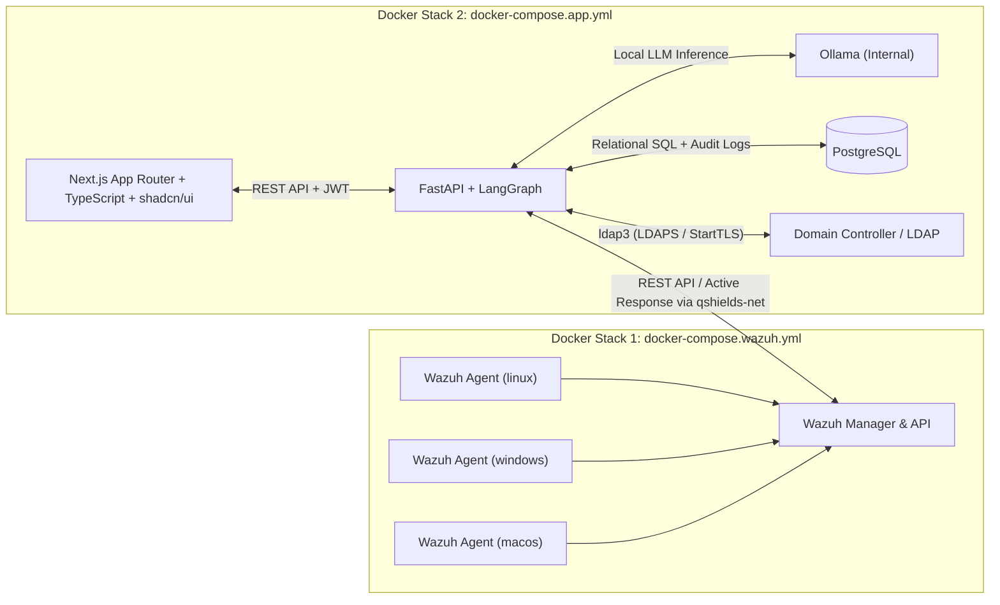

# PROJECT_SPEC.md — Q-Shields Technical & Implementation Specification (Phase 1 MVP)

**Repositori:** `https://github.com/hardiyan46/Q-Shields`  
**Fase Aktif:** Phase 1 (MVP) — *Vibe Coding Ready*  
**Dokumen Terkait:** [docs/PRD-Phase-1.md](docs/PRD-Phase-1.md)  
**Target Sistem Operasi Endpoint:** `linux`, `windows`, `macos`  

---

## 1. Gambaran Umum & Arsitektur Sistem

**Q-Shields** adalah platform internal perusahaan untuk **Vulnerability Assessment (CVE)**, **Hardening / Compliance (CIS Benchmark / SCA)**, dan **AI-Assisted Remediation** dengan mekanisme **Human-in-the-Loop Approval**, **Pre-Change Backup**, **Auto-Revert**, dan **Rollback**.

Seluruh pemrosesan AI dan data keamanan berjalan di jaringan internal berbasis **Docker** tanpa ketergantungan pada layanan LLM eksternal.

### 1.1 Pemisahan Stack Docker (Wajib)
Infrastruktur dijalankan sebagai **dua stack Docker Compose terpisah** agar siklus restart, rebuild, dan iterasi aplikasi selama *vibe coding* tidak mengganggu operasional Wazuh Manager:

1. **Stack Infrastruktur Deteksi (`infra/docker-compose.wazuh.yml`):**
   - Menjalankan `wazuh-manager` (dan komponen Wazuh lain yang dibutuhkan) yang menerima telemetri CVE & SCA/CIS dari **Wazuh Agent** di endpoint `linux`, `windows`, dan `macos`.
2. **Stack Aplikasi Q-Shields (`infra/docker-compose.app.yml`):**
   - `postgres`: PostgreSQL sebagai database relasional utama aplikasi & audit log terstruktur (bukan data stream).
   - `ollama`: Runtime LLM lokal/internal untuk orkestrasi pembuatan skrip.
   - `backend`: Python **FastAPI** + **LangGraph** + `ldap3`.
   - `frontend`: **Next.js (App Router)** + **TypeScript** + **Tailwind CSS** + **shadcn/ui**.
3. **Konektivitas Antar Stack:**
   - Kedua stack terhubung melalui external Docker network bernama `qshields-net` (`docker network create qshields-net`).
   - Backend berkomunikasi dengan Wazuh Manager via REST API / Active Response di jaringan internal tersebut.



---

## 2. Standar Multi-OS (`linux`, `windows`, `macos`)

Nilai **`os_family`** dan **`target_os`** yang valid di seluruh sistem (database, API, LangGraph, dan UI) hanya boleh salah satu dari tiga nilai huruf kecil berikut:
- `"linux"`
- `"windows"`
- `"macos"`

### 2.1 Matriks Bahasa Skrip, Konteks Eksekusi & Direktori Backup

| `os_family` / `target_os` | `script_type` | Ekstensi | Standar Header & Aturan Skrip | Direktori Pre-Change Backup (`backup_path`) | Mekanisme Backup Wajib |
| :--- | :--- | :--- | :--- | :--- | :--- |
| **`linux`** | `bash` | `.sh` | `#!/usr/bin/env bash`<br>`set -euo pipefail`<br>Gunakan path absolut (`/usr/bin/...`, `/etc/...`) dan utilitas POSIX/Linux standar yang aman. | `/var/backups/q-shields/<job_id>/` | Salin file/konfigurasi target beserta atribut/izin (`cp -a` + `stat`), hitung checksum (`sha256sum`), dan simpan daftar paket sebelum perubahan (`dpkg-query -W` atau `rpm -qa`). |
| **`windows`** | `powershell` | `.ps1` | `$ErrorActionPreference = "Stop"`<br>Gunakan path absolut dan konteks layanan **`NT AUTHORITY\SYSTEM`**. **Dilarang** bergantung pada sesi user interaktif, `HKCU:\` user login, UI prompt, atau `$env:USERPROFILE`. | `C:\ProgramData\Q-Shields\backups\<job_id>\` | Salin file konfigurasi target, lakukan `reg export` untuk setiap registry key terkait, hitung hash (`Get-FileHash -Algorithm SHA256`), dan simpan daftar paket/KB sebelum perubahan (`Get-HotFix` / `Get-Package`). |
| **`macos`** | `bsd_shell` | `.sh` | `#!/bin/sh` (atau `#!/bin/zsh` / Bash 3.2 kompatibel)<br>`set -eu`<br>Skrip **BSD-safe**: kompatibel dengan shell bawaan macOS (`zsh` / Bash 3.2). **Dilarang keras** memakai perintah khusus Linux (`systemctl`, `apt-get`, `yum`, `dnf`, `sha256sum`, `sed -i` gaya GNU). Wajib menghormati batasan **Apple SIP**, **TCC**, dan **MDM**. | `/Library/Application Support/Q-Shields/backups/<job_id>/` | Salin file/plist/konfigurasi yang diizinkan (non-SIP/non-TCC), hitung hash (`shasum -a 256`), dan simpan status/daftar paket atau pengaturan awal (`defaults read`, `plutil`, `pkgutil --pkgs`, `launchctl`). |

### 2.2 Aturan Khusus `macos` (Apple SIP, TCC, dan MDM)
1. **Apple System Integrity Protection (SIP):**
   - Skrip tidak boleh mencoba memodifikasi direktori/biner yang dilindungi SIP (misal `/System`, `/usr` selain `/usr/local`, `/bin`, `/sbin`, atau menonaktifkan `csrutil`).
2. **Transparency, Consent, and Control (TCC):**
   - Skrip berjalan di konteks root daemon (Wazuh Agent / LaunchDaemon) dan tidak boleh mengandalkan prompt izin TCC interaktif dari user atau memodifikasi database TCC secara langsung.
3. **Mobile Device Management (MDM):**
   - Pengaturan sistem yang dikunci atau hanya dapat dikelola melalui Configuration Profile MDM (mis. FileVault enforcement terkelola, Gatekeeper policy terkelola MDM, PPPC/Full Disk Access, OS update enforcement tertentu) **tidak boleh** dipaksakan lewat skrip lokal yang akan gagal atau bertabrakan dengan MDM.
4. **Penandaan Wajib Oleh AI:**
   - Jika temuan di `macos` terdeteksi berada di bawah perlindungan SIP, TCC, atau dikunci oleh kebijakan MDM:
     - `remediation_feasibility` wajib disetel ke `"MANUAL_OR_MDM_REQUIRED"`.
     - `has_pre_backup` wajib bernilai `false` (sehingga tombol **Approve** otomatis terkunci dan tidak dapat dieksekusi).
     - `status` job disetel ke `"MANUAL_REQUIRED"`.
     - `manual_action_notes` wajib berisi penjelasan rinci alasan teknis (SIP/TCC/MDM) serta langkah manual atau profil MDM yang diperlukan oleh administrator.

---

## 3. Aturan Wajib Pre-Change Backup, Auto-Revert & Rollback

### 3.1 Kontrak Alur Eksekusi Skrip Remediasi
Setiap `remediation_script` (untuk job `remediation_feasibility = "AUTO_SAFE"`) wajib memiliki 4 fase berurutan di dalam skripnya:

1. **Fase 1 — Pre-Change Backup (Sebelum Perubahan Apa Pun):**
   - Membuat direktori `backup_path` unik per `<job_id>`.
   - Mencadangkan seluruh `backup_targets` (file konfigurasi, atribut/izin, registry via `reg export` di Windows, plist/pengaturan awal di macOS) serta snapshot daftar paket/KB/service sebelum perubahan.
   - Menghasilkan manifest checksum SHA-256 (`manifest.sha256` / `manifest.sha256.json`).
   - **Fail-Fast Rule:** Jika tahap backup gagal (misal disk penuh, target tidak dapat dibaca, izin ditolak), skrip **wajib berhenti seketika (non-zero exit)** sebelum menyentuh konfigurasi atau paket apa pun.
2. **Fase 2 — Apply Change:**
   - Menerapkan perubahan konfigurasi, registry/plist, service/daemon, atau paket secara idempotent.
3. **Fase 3 — Post-Change Verification / Validation:**
   - Menjalankan pengecekan konfigurasi dan kesehatan layanan (misal `sshd -t`, status service `launchctl`/`Get-Service`/`systemctl`, atau verifikasi nilai target).
4. **Fase 4 — Auto-Revert Otomatis Jika Validasi Gagal:**
   - Menggunakan mekanisme trap/error handler (`trap` di Linux/macOS atau `try/catch` di PowerShell) sehingga apabila fase Apply atau Validation gagal setelah perubahan dimulai, skrip **otomatis mengembalikan seluruh target dari `backup_path` milik `<job_id>`**, me-restart/reload layanan terkait ke kondisi awal, dan mengembalikan kode/marker status `AUTO_REVERTED` agar backend mencatat status job menjadi **`ROLLED_BACK`**.

### 3.2 Kontrak `rollback_script` Terpisah
- AI (LangGraph + Ollama) **wajib** menghasilkan kolom `rollback_script` secara terpisah dari `remediation_script`.
- `rollback_script` **wajib** merujuk secara eksplisit ke direktori `backup_path` milik `<job_id>` yang sama, memverifikasi integritas file backup (checksum), memulihkan kondisi awal (file/izin/registry/plist/layanan), dan tidak bergantung pada state di memori.
- Ketika operator/approver/admin memicu manual rollback pada job `COMPLETED` atau `FAILED` melalui `POST /api/v1/jobs/{id}/rollback`, sistem menjalankan `rollback_script` tersebut dan setelah berhasil memperbarui status job di PostgreSQL menjadi **`ROLLED_BACK`** (beserta pencatatan di `job_execution_logs` dan `audit_logs`).

### 3.3 Contoh Pola Skrip per OS

#### A. `linux` (`bash`, `.sh`)
```bash
#!/usr/bin/env bash
set -euo pipefail

JOB_ID="550e8400-e29b-41d4-a716-446655440000"
BACKUP_DIR="/var/backups/q-shields/${JOB_ID}"
TARGET_FILE="/etc/ssh/sshd_config"

revert_from_backup() {
  if [ -f "${BACKUP_DIR}/sshd_config.bak" ]; then
    cp -a "${BACKUP_DIR}/sshd_config.bak" "${TARGET_FILE}"
    systemctl reload sshd || service ssh reload || true
  fi
}

# 1. Pre-Change Backup
mkdir -p "${BACKUP_DIR}"
chmod 700 "${BACKUP_DIR}"
cp -a "${TARGET_FILE}" "${BACKUP_DIR}/sshd_config.bak"
stat -c '%a %u %g %n' "${TARGET_FILE}" > "${BACKUP_DIR}/permissions.txt"
sha256sum "${BACKUP_DIR}/sshd_config.bak" > "${BACKUP_DIR}/manifest.sha256"
(dpkg-query -W -f='${Package}=${Version}\n' 2>/dev/null || rpm -qa 2>/dev/null || true) > "${BACKUP_DIR}/packages_before.txt"

# 2. Apply + 3. Validate + 4. Auto-Revert on Failure
trap 'echo "[AUTO_REVERT] Validation failed, restoring backup"; revert_from_backup; exit 10' ERR

sed -i 's/^#\?PermitRootLogin.*/PermitRootLogin no/' "${TARGET_FILE}"
/usr/sbin/sshd -t
systemctl reload sshd
```

#### B. `windows` (`powershell`, `.ps1` — Konteks `NT AUTHORITY\SYSTEM`)
```powershell
$ErrorActionPreference = "Stop"

$JobId = "550e8400-e29b-41d4-a716-446655440000"
$BackupDir = "C:\ProgramData\Q-Shields\backups\$JobId"
$RegKey = "HKLM\SYSTEM\CurrentControlSet\Services\LanmanServer\Parameters"
$RegBackup = "$BackupDir\LanmanServer_Parameters.reg"

function Invoke-AutoRevert {
    if (Test-Path $RegBackup) {
        & reg.exe import $RegBackup | Out-Null
    }
}

# 1. Pre-Change Backup
New-Item -ItemType Directory -Path $BackupDir -Force | Out-Null
& reg.exe export $RegKey $RegBackup /y | Out-Null
Get-FileHash -Path $RegBackup -Algorithm SHA256 | Export-Csv -Path "$BackupDir\manifest.csv" -NoTypeInformation
Get-HotFix | Select-Object HotFixID, InstalledOn | Export-Csv -Path "$BackupDir\packages_before.csv" -NoTypeInformation

# 2. Apply + 3. Validate + 4. Auto-Revert on Failure
try {
    Set-ItemProperty -Path "HKLM:\SYSTEM\CurrentControlSet\Services\LanmanServer\Parameters" -Name "SMB1" -Value 0 -Type DWord
    $val = (Get-ItemProperty -Path "HKLM:\SYSTEM\CurrentControlSet\Services\LanmanServer\Parameters").SMB1
    if ($val -ne 0) { throw "Validation failed: SMB1 registry value mismatch" }
}
catch {
    Invoke-AutoRevert
    Write-Error "[AUTO_REVERT] $_"
    exit 10
}
```

#### C. `macos` (`bsd_shell`, `.sh` — BSD-safe, Non-SIP/TCC/MDM)
```sh
#!/bin/sh
set -eu

JOB_ID="550e8400-e29b-41d4-a716-446655440000"
BACKUP_DIR="/Library/Application Support/Q-Shields/backups/${JOB_ID}"
PLIST_PATH="/Library/Preferences/com.apple.alf.plist"

revert_from_backup() {
  if [ -f "${BACKUP_DIR}/com.apple.alf.plist.bak" ]; then
    cp -p "${BACKUP_DIR}/com.apple.alf.plist.bak" "${PLIST_PATH}"
    /usr/libexec/ApplicationFirewall/socketfilterfw --setglobalstate on >/dev/null 2>&1 || true
  fi
}

# 1. Pre-Change Backup
mkdir -p "${BACKUP_DIR}"
chmod 700 "${BACKUP_DIR}"
if [ -f "${PLIST_PATH}" ]; then
  cp -p "${PLIST_PATH}" "${BACKUP_DIR}/com.apple.alf.plist.bak"
  shasum -a 256 "${BACKUP_DIR}/com.apple.alf.plist.bak" > "${BACKUP_DIR}/manifest.sha256"
fi
/usr/sbin/pkgutil --pkgs > "${BACKUP_DIR}/packages_before.txt"
/usr/bin/defaults read /Library/Preferences/com.apple.alf > "${BACKUP_DIR}/alf_defaults_before.txt" 2>/dev/null || true

# 2. Apply + 3. Validate + 4. Auto-Revert on Failure
if ! (
  /usr/libexec/ApplicationFirewall/socketfilterfw --setglobalstate on &&
  /usr/libexec/ApplicationFirewall/socketfilterfw --getglobalstate | grep -q "enabled"
); then
  echo "[AUTO_REVERT] Validation failed, restoring macOS backup" >&2
  revert_from_backup
  exit 10
fi
```

---

## 4. State Machine & Aturan Validasi Wajib

### 4.1 Enum Status `remediation_jobs`
- `GENERATING`: LangGraph sedang menyusun skrip melalui Ollama/Mock LLM.
- `PENDING_APPROVAL`: Skrip selesai dibuat & lolos validasi struktur untuk ditinjau `APPROVER`.
- `MANUAL_REQUIRED`: Khusus ketika remediasi otomatis tidak aman (mis. diblokir Apple SIP, TCC, atau kebijakan MDM di `macos`). Tidak dapat di-Approve atau dieksekusi otomatis.
- `APPROVED`: Disetujui oleh `APPROVER` atau `ADMIN` (`has_pre_backup == true` wajib terpenuhi).
- `REJECTED`: Ditolak oleh `APPROVER` atau `ADMIN` dengan alasan wajib.
- `EXECUTING`: Sedang dijalankan di endpoint target melalui Wazuh Active Response / Runner.
- `COMPLETED`: Pre-change backup, penerapan perubahan, dan validasi pasca-perubahan berhasil.
- `FAILED`: Gagal pada tahap pre-backup, atau auto-revert gagal memulihkan sistem.
- `ROLLED_BACK`: Sistem telah dipulihkan dari `backup_path` (baik lewat **auto-revert** saat validasi gagal maupun **manual rollback** via `rollback_script`).

### 4.2 Aturan Kunci Validasi (UI + FastAPI Guard)
1. **Approval Guard (`has_pre_backup == true`):**
   - UI menonaktifkan (`disabled`) tombol **Approve** jika `has_pre_backup === false` atau `status !== 'PENDING_APPROVAL'` atau `remediation_feasibility !== 'AUTO_SAFE'`.
   - Endpoint `POST /api/v1/jobs/{id}/approve` wajib memvalidasi ulang di backend dan mengembalikan **HTTP `422 Unprocessable Entity`** jika `has_pre_backup` bernilai `false` atau `remediation_feasibility !== 'AUTO_SAFE'`, serta **HTTP `409 Conflict`** jika status bukan `PENDING_APPROVAL`.
2. **Execution Guard (`status == 'APPROVED'`):**
   - **Dilarang keras mengeksekusi job apabila status bukan `APPROVED`.**
   - UI hanya mengizinkan tombol **Execute** saat `status === 'APPROVED'`.
   - Endpoint `POST /api/v1/jobs/{id}/execute` wajib memvalidasi `job.status == 'APPROVED'` (dan `job.has_pre_backup is True`); jika tidak, tolak dengan **HTTP `409 Conflict`** dan catat percobaan tidak sah ke `audit_logs`.

---

## 5. Autentikasi Ganda (Local + Domain Controller / LDAP) & RBAC

- **Akun Lokal (`auth_provider = 'LOCAL'`):** Password di-hash menggunakan `Argon2id` atau `bcrypt` dan disimpan di `users.password_hash`.
- **Akun LDAP (`auth_provider = 'LDAP'`):** Menggunakan Python `ldap3` untuk bind langsung ke Domain Controller (LDAPS/StartTLS direkomendasikan). **Password LDAP dilarang keras disimpan ke PostgreSQL** (`password_hash` wajib `NULL`).
- **RBAC Roles:** `OPERATOR`, `APPROVER`, `ADMIN`.
- **Pemetaan Grup LDAP (`ldap_group_mappings`):** Grup `memberOf` dipetakan ke role RBAC berdasarkan prioritas tertinggi (`ADMIN` > `APPROVER` > `OPERATOR`). Jika tidak ada grup yang cocok, sistem **wajib memberikan default role terendah (`OPERATOR`)**.

---

## 6. Desain Skema Database PostgreSQL (Sinkron dengan PRD)

Database menggunakan tabel relasional terstruktur dengan indeks (bukan data stream):

```sql
CREATE EXTENSION IF NOT EXISTS "pgcrypto";

CREATE TABLE users (
    id UUID PRIMARY KEY DEFAULT gen_random_uuid(),
    username VARCHAR(100) NOT NULL UNIQUE,
    display_name VARCHAR(150),
    email VARCHAR(255),
    auth_provider VARCHAR(20) NOT NULL CHECK (auth_provider IN ('LOCAL', 'LDAP')),
    password_hash TEXT,
    external_dn TEXT,
    last_synced_ldap_groups JSONB NOT NULL DEFAULT '[]'::jsonb,
    role VARCHAR(20) NOT NULL DEFAULT 'OPERATOR' CHECK (role IN ('OPERATOR', 'APPROVER', 'ADMIN')),
    is_active BOOLEAN NOT NULL DEFAULT TRUE,
    last_login_at TIMESTAMPTZ,
    created_at TIMESTAMPTZ NOT NULL DEFAULT NOW(),
    updated_at TIMESTAMPTZ NOT NULL DEFAULT NOW(),
    CONSTRAINT chk_local_has_password CHECK (
        (auth_provider = 'LOCAL' AND password_hash IS NOT NULL) OR
        (auth_provider = 'LDAP' AND password_hash IS NULL)
    )
);

CREATE TABLE ldap_group_mappings (
    id UUID PRIMARY KEY DEFAULT gen_random_uuid(),
    ldap_group_dn TEXT NOT NULL UNIQUE,
    ldap_group_cn VARCHAR(150) NOT NULL,
    assigned_role VARCHAR(20) NOT NULL CHECK (assigned_role IN ('OPERATOR', 'APPROVER', 'ADMIN')),
    priority INT NOT NULL DEFAULT 100,
    is_active BOOLEAN NOT NULL DEFAULT TRUE,
    created_at TIMESTAMPTZ NOT NULL DEFAULT NOW(),
    updated_at TIMESTAMPTZ NOT NULL DEFAULT NOW()
);

CREATE TABLE endpoints (
    id UUID PRIMARY KEY DEFAULT gen_random_uuid(),
    wazuh_agent_id VARCHAR(64) NOT NULL UNIQUE,
    hostname VARCHAR(255) NOT NULL,
    ip_address INET,
    os_family VARCHAR(20) NOT NULL CHECK (os_family IN ('linux', 'windows', 'macos')),
    os_name VARCHAR(150),
    os_version VARCHAR(100),
    agent_version VARCHAR(50),
    connection_status VARCHAR(30) NOT NULL DEFAULT 'DISCONNECTED',
    last_seen_at TIMESTAMPTZ,
    -- Kesiapan Phase 2 (Canary Deployment)
    is_canary_eligible BOOLEAN NOT NULL DEFAULT FALSE,
    environment_tier VARCHAR(30) NOT NULL DEFAULT 'PRODUCTION',
    -- Kesiapan Phase 3 (Telemetry & EDR)
    isolation_status VARCHAR(20) NOT NULL DEFAULT 'NONE' CHECK (isolation_status IN ('NONE', 'ISOLATING', 'ISOLATED')),
    telemetry_agent_version VARCHAR(50),
    created_at TIMESTAMPTZ NOT NULL DEFAULT NOW(),
    updated_at TIMESTAMPTZ NOT NULL DEFAULT NOW()
);

CREATE TABLE findings (
    id UUID PRIMARY KEY DEFAULT gen_random_uuid(),
    endpoint_id UUID NOT NULL REFERENCES endpoints(id) ON DELETE CASCADE,
    source_type VARCHAR(20) NOT NULL CHECK (source_type IN ('CVE', 'SCA_CIS', 'SIGMA')),
    external_ref_id VARCHAR(150) NOT NULL,
    title TEXT NOT NULL,
    description TEXT,
    severity VARCHAR(20) NOT NULL CHECK (severity IN ('CRITICAL', 'HIGH', 'MEDIUM', 'LOW', 'INFO')),
    status VARCHAR(20) NOT NULL DEFAULT 'OPEN' CHECK (status IN ('OPEN', 'IN_PROGRESS', 'RESOLVED', 'IGNORED')),
    affected_package VARCHAR(255),
    remediation_hint TEXT,
    raw_payload JSONB NOT NULL DEFAULT '{}'::jsonb,
    -- Kesiapan Phase 3 (Sigma Rules)
    sigma_rule_id VARCHAR(128),
    first_detected_at TIMESTAMPTZ NOT NULL DEFAULT NOW(),
    last_detected_at TIMESTAMPTZ NOT NULL DEFAULT NOW(),
    UNIQUE (endpoint_id, source_type, external_ref_id)
);

CREATE TABLE remediation_jobs (
    id UUID PRIMARY KEY DEFAULT gen_random_uuid(),
    endpoint_id UUID NOT NULL REFERENCES endpoints(id) ON DELETE CASCADE,
    finding_id UUID NOT NULL REFERENCES findings(id) ON DELETE CASCADE,
    created_by UUID NOT NULL REFERENCES users(id),
    approved_by UUID REFERENCES users(id),
    target_os VARCHAR(20) NOT NULL CHECK (target_os IN ('linux', 'windows', 'macos')),
    script_type VARCHAR(20) NOT NULL CHECK (script_type IN ('bash', 'powershell', 'bsd_shell')),
    ai_model_used VARCHAR(100),
    ai_summary TEXT,

    -- Kelayakan & Penanganan SIP/TCC/MDM (macOS)
    remediation_feasibility VARCHAR(30) NOT NULL DEFAULT 'AUTO_SAFE' CHECK (
        remediation_feasibility IN ('AUTO_SAFE', 'MANUAL_OR_MDM_REQUIRED')
    ),
    manual_action_notes TEXT,

    -- Skrip & Kontrol Pre-Change Backup (Wajib Phase 1)
    remediation_script TEXT NOT NULL,
    validation_script TEXT,
    rollback_script TEXT NOT NULL,
    backup_path VARCHAR(512) NOT NULL,
    backup_targets JSONB NOT NULL DEFAULT '[]'::jsonb,
    backup_checksum VARCHAR(128),
    has_pre_backup BOOLEAN NOT NULL DEFAULT FALSE,

    -- Status Lifecycle (Mencakup MANUAL_REQUIRED & ROLLED_BACK)
    status VARCHAR(30) NOT NULL DEFAULT 'GENERATING' CHECK (
        status IN (
            'GENERATING',
            'PENDING_APPROVAL',
            'MANUAL_REQUIRED',
            'APPROVED',
            'REJECTED',
            'EXECUTING',
            'COMPLETED',
            'FAILED',
            'ROLLED_BACK'
        )
    ),
    rejection_reason TEXT,
    approved_at TIMESTAMPTZ,
    executed_at TIMESTAMPTZ,
    completed_at TIMESTAMPTZ,
    rolled_back_at TIMESTAMPTZ,

    -- Kesiapan Phase 2 (Static Analyzer & Canary Deployment)
    static_analysis_status VARCHAR(20) NOT NULL DEFAULT 'NOT_RUN' CHECK (
        static_analysis_status IN ('NOT_RUN', 'PASSED', 'WARNING', 'FAILED')
    ),
    static_analysis_report JSONB,
    analyzed_at TIMESTAMPTZ,
    deployment_strategy VARCHAR(20) NOT NULL DEFAULT 'SINGLE' CHECK (
        deployment_strategy IN ('SINGLE', 'CANARY_FIRST', 'BATCH')
    ),
    canary_endpoint_id UUID REFERENCES endpoints(id),
    canary_job_id UUID REFERENCES remediation_jobs(id),

    created_at TIMESTAMPTZ NOT NULL DEFAULT NOW(),
    updated_at TIMESTAMPTZ NOT NULL DEFAULT NOW()
);

CREATE TABLE job_execution_logs (
    id UUID PRIMARY KEY DEFAULT gen_random_uuid(),
    job_id UUID NOT NULL REFERENCES remediation_jobs(id) ON DELETE CASCADE,
    stage VARCHAR(30) NOT NULL CHECK (
        stage IN ('PRE_BACKUP', 'REMEDIATION', 'VALIDATION', 'AUTO_REVERT', 'MANUAL_ROLLBACK')
    ),
    exit_code INT,
    stdout TEXT,
    stderr TEXT,
    executed_at TIMESTAMPTZ NOT NULL DEFAULT NOW()
);

CREATE TABLE audit_logs (
    id UUID PRIMARY KEY DEFAULT gen_random_uuid(),
    actor_user_id UUID REFERENCES users(id) ON DELETE SET NULL,
    actor_username VARCHAR(100) NOT NULL,
    actor_role VARCHAR(20),
    action VARCHAR(64) NOT NULL,
    resource_type VARCHAR(50) NOT NULL,
    resource_id VARCHAR(100),
    status VARCHAR(20) NOT NULL DEFAULT 'SUCCESS' CHECK (status IN ('SUCCESS', 'FAILURE', 'DENIED')),
    ip_address INET,
    metadata JSONB NOT NULL DEFAULT '{}'::jsonb,
    created_at TIMESTAMPTZ NOT NULL DEFAULT NOW()
);

-- Kesiapan Phase 3 (Telemetri Real-Time & Aksi Cepat EDR)
CREATE TABLE telemetry_events (
    id UUID PRIMARY KEY DEFAULT gen_random_uuid(),
    endpoint_id UUID NOT NULL REFERENCES endpoints(id) ON DELETE CASCADE,
    source_sensor VARCHAR(20) NOT NULL CHECK (source_sensor IN ('SYSMON', 'EBPF')),
    event_type VARCHAR(64) NOT NULL,
    sigma_rule_id VARCHAR(128),
    severity VARCHAR(20) NOT NULL DEFAULT 'INFO',
    process_name VARCHAR(255),
    process_pid INT,
    payload JSONB NOT NULL DEFAULT '{}'::jsonb,
    occurred_at TIMESTAMPTZ NOT NULL,
    ingested_at TIMESTAMPTZ NOT NULL DEFAULT NOW()
);

CREATE TABLE edr_actions (
    id UUID PRIMARY KEY DEFAULT gen_random_uuid(),
    endpoint_id UUID NOT NULL REFERENCES endpoints(id) ON DELETE CASCADE,
    triggered_by UUID NOT NULL REFERENCES users(id),
    action_type VARCHAR(30) NOT NULL CHECK (action_type IN ('ISOLATE_HOST', 'UNISOLATE_HOST', 'KILL_PROCESS', 'QUARANTINE_FILE')),
    target_artifact TEXT NOT NULL,
    status VARCHAR(20) NOT NULL DEFAULT 'PENDING' CHECK (status IN ('PENDING', 'EXECUTING', 'COMPLETED', 'FAILED')),
    result_message TEXT,
    created_at TIMESTAMPTZ NOT NULL DEFAULT NOW(),
    completed_at TIMESTAMPTZ
);

-- Indeks relasional utama
CREATE INDEX idx_users_auth_provider ON users(auth_provider);
CREATE INDEX idx_users_role ON users(role);
CREATE INDEX idx_endpoints_os_family ON endpoints(os_family);
CREATE INDEX idx_endpoints_connection_status ON endpoints(connection_status);
CREATE INDEX idx_findings_endpoint_status ON findings(endpoint_id, status);
CREATE INDEX idx_findings_severity_status ON findings(severity, status);
CREATE INDEX idx_findings_source_type ON findings(source_type);
CREATE INDEX idx_jobs_status ON remediation_jobs(status);
CREATE INDEX idx_jobs_has_pre_backup ON remediation_jobs(has_pre_backup);
CREATE INDEX idx_jobs_endpoint_id ON remediation_jobs(endpoint_id);
CREATE INDEX idx_jobs_created_by ON remediation_jobs(created_by);
CREATE INDEX idx_job_exec_logs_job_id ON job_execution_logs(job_id, executed_at);
CREATE INDEX idx_audit_logs_created_at ON audit_logs(created_at DESC);
CREATE INDEX idx_audit_logs_actor ON audit_logs(actor_user_id, created_at DESC);
CREATE INDEX idx_audit_logs_action ON audit_logs(action);
CREATE INDEX idx_telemetry_endpoint_time ON telemetry_events(endpoint_id, occurred_at DESC);
CREATE INDEX idx_telemetry_sigma_rule ON telemetry_events(sigma_rule_id);
CREATE INDEX idx_edr_actions_endpoint ON edr_actions(endpoint_id, created_at DESC);
```

---

## 7. Kontrak API & LangGraph Structured Output

### 7.1 Daftar Endpoint API Inti (`/api/v1`)
| Method & Path | Role Diizinkan | Aturan Validasi Utama |
| :--- | :--- | :--- |
| `POST /auth/login` | Public | Mendukung `LOCAL` (hash verify) & `LDAP` (`ldap3`, tanpa simpan password, fallback role `OPERATOR`). |
| `GET /endpoints` | `OPERATOR`, `APPROVER`, `ADMIN` | Filter `os_family` (`linux` \| `windows` \| `macos`), `connection_status`. |
| `GET /findings` | `OPERATOR`, `APPROVER`, `ADMIN` | Filter `endpoint_id`, `source_type`, `severity`, `status`. |
| `POST /sync/wazuh` | `OPERATOR`, `APPROVER`, `ADMIN` | Adapter `WAZUH_MODE=mock\|live`, upsert idempotent untuk `linux`, `windows`, `macos`. |
| `POST /jobs/generate` | `OPERATOR`, `ADMIN` | Menjalankan LangGraph (`context_builder` → `script_generator` → `safety_validator`). |
| `GET /jobs` & `GET /jobs/{id}` | `OPERATOR`, `APPROVER`, `ADMIN` | Mengembalikan skrip, `backup_path`, `backup_targets`, `has_pre_backup`, `remediation_feasibility`, `manual_action_notes`, `status`. |
| `POST /jobs/{id}/approve` | `APPROVER`, `ADMIN` | **Wajib** `status == 'PENDING_APPROVAL'`, `has_pre_backup == true`, dan `remediation_feasibility == 'AUTO_SAFE'` (HTTP `422`/`409` jika gagal). |
| `POST /jobs/{id}/reject` | `APPROVER`, `ADMIN` | Wajib `rejection_reason` non-kosong. |
| `POST /jobs/{id}/execute` | `OPERATOR`, `ADMIN` | **Wajib** `status == 'APPROVED'` (HTTP `409` jika bukan `APPROVED`). |
| `POST /jobs/{id}/rollback` | `OPERATOR`, `APPROVER`, `ADMIN` | Hanya untuk `status IN ('COMPLETED', 'FAILED')`, mengeksekusi `rollback_script` → `ROLLED_BACK`. |
| `GET/POST /admin/users` & `ldap-mappings` | `ADMIN` | Manajemen user lokal & pemetaan grup LDAP. |
| `GET /audit-logs` | `APPROVER`, `ADMIN` | Read-only & terindeks (tidak ada endpoint mutasi/hapus). |

### 7.2 Kontrak Output LangGraph (`AIRemediationOutput`)
```json
{
  "target_os": "linux | windows | macos",
  "script_type": "bash | powershell | bsd_shell",
  "remediation_feasibility": "AUTO_SAFE | MANUAL_OR_MDM_REQUIRED",
  "manual_action_notes": "Diisi jika diblokir SIP/TCC/MDM di macOS atau butuh aksi manual.",
  "ai_summary": "Ringkasan perubahan dan validasi.",
  "backup_path": "/var/backups/q-shields/<job_id>/ | C:\\ProgramData\\Q-Shields\\backups\\<job_id>\\ | /Library/Application Support/Q-Shields/backups/<job_id>/",
  "backup_targets": ["path/atau/registry/atau/plist"],
  "remediation_script": "Skrip lengkap dengan Pre-Change Backup, Apply, Validation, dan Auto-Revert",
  "validation_script": "Skrip atau perintah verifikasi pasca-perubahan",
  "rollback_script": "Skrip rollback mandiri yang merujuk ke backup_path milik <job_id>"
}
```

---

## 8. Kesiapan Phase 2 & Phase 3 (Out-of-Scope Phase 1)

| Fase | Fitur | Integrasi ke Desain Phase 1 |
| :--- | :--- | :--- |
| **Phase 2** | Static Code Analyzer (`ShellCheck` untuk `linux`/`macos` shell & `PSScriptAnalyzer` untuk `windows` PowerShell) sebelum approval; **Canary Deployment** (uji ke 1 PC/host canary sebelum push massal). | Memanfaatkan kolom `static_analysis_status`, `static_analysis_report`, `analyzed_at`, `deployment_strategy`, `canary_endpoint_id`, `canary_job_id`, dan `endpoints.is_canary_eligible`. |
| **Phase 3** | Telemetri real-time (`Sysmon` untuk Windows, `eBPF` untuk Linux/sensor terkait), deteksi `Sigma Rules`, serta aksi cepat EDR (`Isolate Host`, `Kill Process`, `Quarantine File`). | Memanfaatkan tabel `telemetry_events`, `edr_actions`, `endpoints.isolation_status`, `endpoints.telemetry_agent_version`, dan `findings.sigma_rule_id`. |
