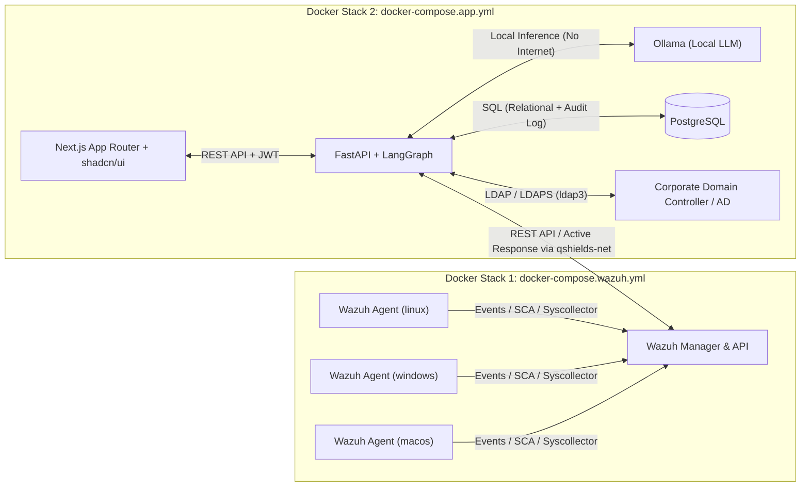
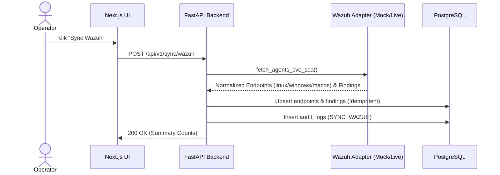
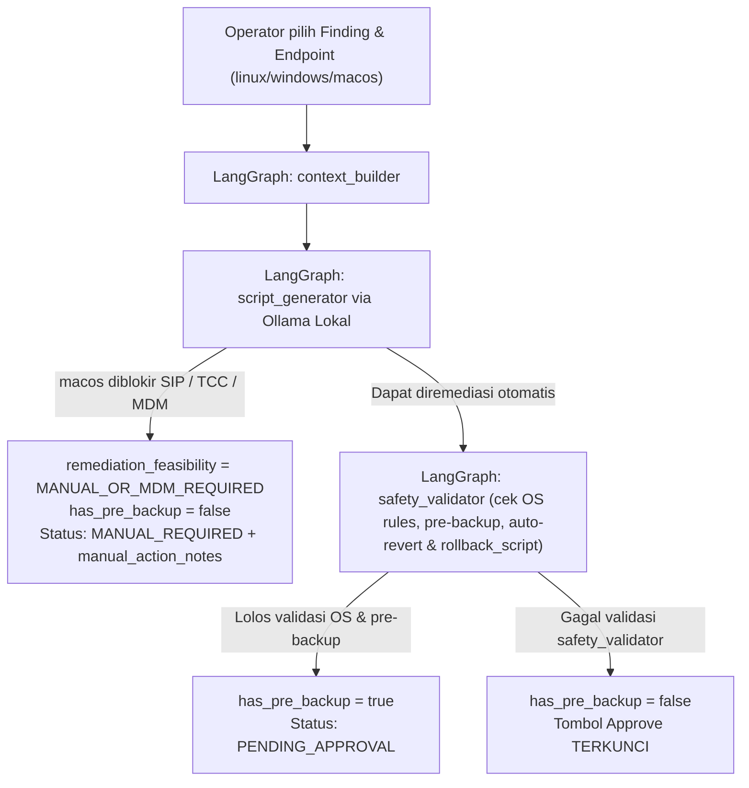
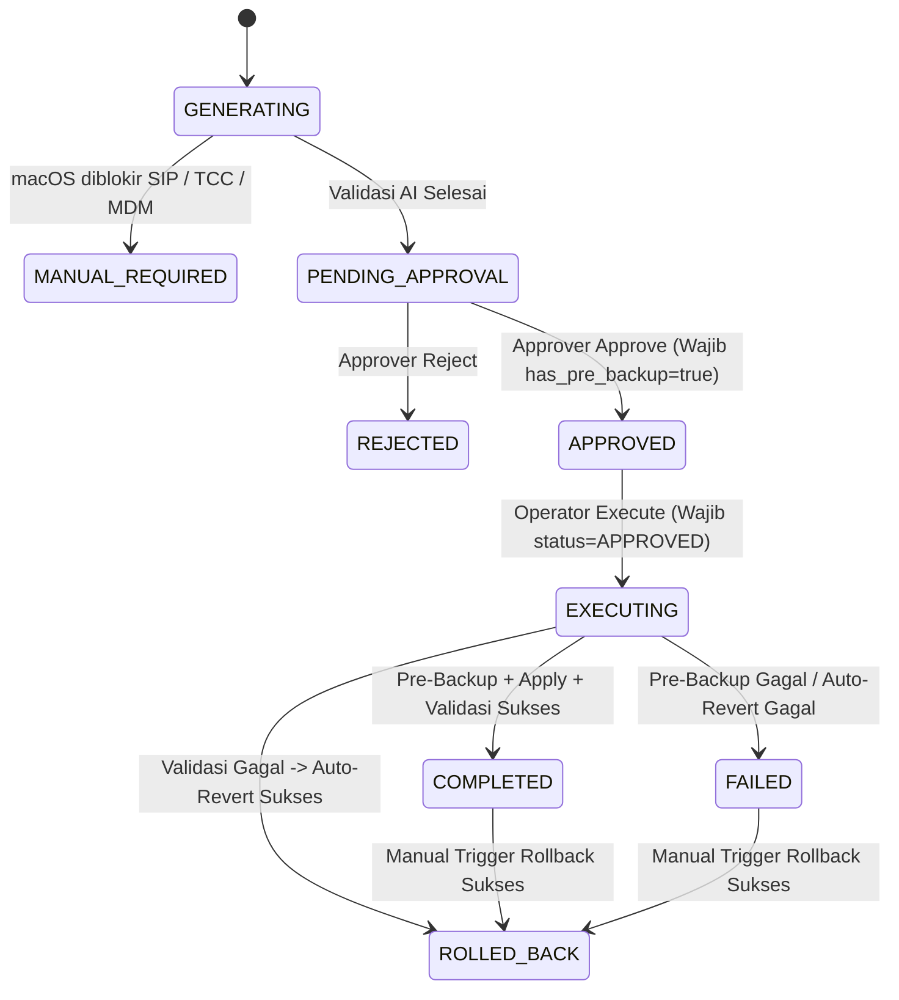
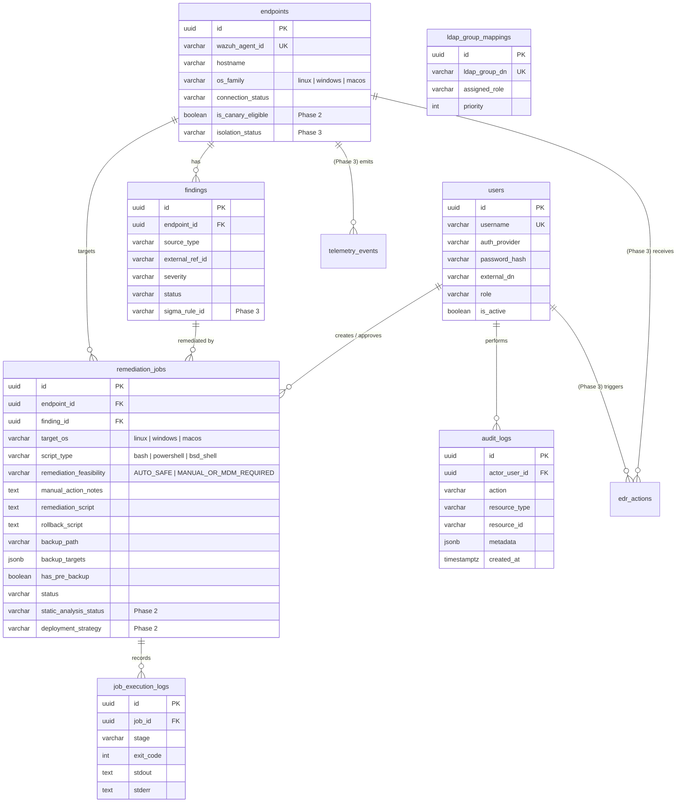

# Product Requirements Document (PRD) — Q-Shields Phase 1 (MVP)

**Proyek:** Q-Shields (`https://github.com/hardiyan46/Q-Shields`)  
**Fase:** Phase 1 — Minimum Viable Product (MVP)  
**Metodologi Pengembangan:** Vibe Coding (Contract-First & Mock-First)  
**Lingkungan Target:** Internal On-Premise / Private Corporate Network (Berbasis Docker)  
**Target OS Endpoint:** `linux`, `windows`, `macos`  
**Dokumen Pendamping:** [PROJECT_SPEC.md](../PROJECT_SPEC.md)  
**Status Dokumen:** Final Draft (Ready for Vibe Coding Execution)  

---

## Daftar Isi

1. [Ringkasan Eksekutif & Masalah yang Diselesaikan](#1-ringkasan-eksekutif--masalah-yang-diselesaikan)
2. [User Personas & RBAC Matrix](#2-user-personas--rbac-matrix)
3. [Scope Phase 1 (In-Scope vs Out-of-Scope)](#3-scope-phase-1-in-scope-vs-out-of-scope)
4. [End-to-End User Flows](#4-end-to-end-user-flows)
5. [Functional & Non-Functional Requirements](#5-functional--non-functional-requirements)
6. [Desain Skema Database PostgreSQL](#6-desain-skema-database-postgresql)
7. [Rencana Sprint Vibe Coding Phase 1](#7-rencana-sprint-vibe-coding-phase-1)
8. [Lampiran: Referensi Arsitektur Docker & Kontrak Data Multi-OS](#8-lampiran-referensi-arsitektur-docker--kontrak-data-multi-os)

---

## 1. Ringkasan Eksekutif & Masalah yang Diselesaikan

### 1.1 Latar Belakang & Masalah Utama
Tim Security Operations dan IT Infrastructure di lingkungan internal perusahaan sering menghadapi kesenjangan operasional antara **deteksi kerentanan/kepatuhan** dengan **eksekusi perbaikan (remediasi)** di ratusan hingga ribuan endpoint heterogen (**`linux`**, **`windows`**, dan **`macos`**):

1. **Banjir Temuan Tanpa Jalur Remediasi Cepat:** Agent keamanan seperti Wazuh mampu mendeteksi ribuan CVE dan penyimpangan *CIS Benchmark / Security Configuration Assessment (SCA)* di berbagai OS, namun penyusunan skrip perbaikan lintas-OS masih dilakukan secara manual oleh engineer.
2. **Risiko Kerusakan Sistem Saat Remediasi:** Eksekusi skrip hardening atau patching secara langsung tanpa mekanisme cadangan kondisi awal (*pre-change backup*) dan prosedur pemulihan (*rollback*) berisiko memutus layanan produksi atau merusak konfigurasi sistem. Khusus di `macos`, upaya remediasi otomatis yang menabrak batasan Apple **SIP**, **TCC**, atau kebijakan **MDM** juga berisiko gagal atau melanggar tata kelola perangkat.
3. **Kurangnya Kontrol *Human-in-the-Loop* & Auditabilitas:** Skrip yang dijalankan secara ad-hoc via SSH/WinRM/remote shell sulit dilacak siapa yang membuat, siapa yang menyetujui, apa perubahan persisnya, dan bagaimana membatalkannya saat terjadi insiden.
4. **Kebijakan Privasi Data Internal:** Informasi topologi server/workstation, daftar CVE internal, hostname, dan konfigurasi sensitif dilarang dikirim ke API LLM publik (cloud eksternal).

### 1.2 Solusi: Q-Shields Phase 1 (MVP)
**Q-Shields** adalah platform keamanan endpoint internal berbasis web untuk **Vulnerability Assessment (CVE)**, **Hardening / Compliance (CIS Benchmark / SCA)**, dan **AI-Assisted Remediation dengan Human-in-the-Loop Approval** yang mendukung endpoint **`linux`**, **`windows`**, dan **`macos`**.

Platform ini menggabungkan deteksi **Wazuh** (Agent + Manager), penyimpanan terstruktur di **PostgreSQL**, orkestrasi AI lokal menggunakan **Python FastAPI + LangGraph + Ollama** (100% di jaringan internal), serta antarmuka modern **Next.js (App Router) + TypeScript + Tailwind CSS + shadcn/ui**.

Setiap skrip remediasi yang dapat dijalankan otomatis **wajib** melakukan **Pre-Change Backup** sesuai standar direktori OS target (`/var/backups/q-shields/<job_id>/` untuk `linux`, `C:\ProgramData\Q-Shields\backups\<job_id>\` untuk `windows`, `/Library/Application Support/Q-Shields/backups/<job_id>/` untuk `macos`) beserta **auto-revert** jika validasi gagal, serta menghasilkan **`rollback_script` terpisah**. Tanpa jaminan `has_pre_backup == true`, tombol **Approve** di UI akan terkunci (*hard-locked*), dan job yang statusnya bukan `APPROVED` dilarang keras dieksekusi.

### 1.3 Arsitektur Stack & Prinsip Vibe Coding
Karena Phase 1 dibangun secara bertahap melalui **vibe coding** (bukan coding fullstack manual dari nol), PRD ini menetapkan empat pilar disiplin agar pengembangan tidak macet di tengah jalan:

| Prinsip | Implementasi Teknis di Q-Shields |
| :--- | :--- |
| **1. Pemisahan Stack Docker** | Stack **Wazuh** (`docker-compose.wazuh.yml`) dan stack aplikasi **Q-Shields** (`docker-compose.app.yml`: PostgreSQL, Ollama, FastAPI Backend, Next.js Frontend) dijalankan terpisah dan berkomunikasi melalui Docker external network (`qshields-net`) dan REST API/TLS. Jika aplikasi Q-Shields di-restart saat vibe coding, Wazuh Manager tidak ikut terganggu. |
| **2. Contract-First Development** | Seluruh pertukaran data antar komponen (API FastAPI ↔ Next.js, LangGraph ↔ Ollama Structured Output, Wazuh Adapter ↔ Database) harus mengikuti skema Pydantic/JSON dan TypeScript interface yang didefinisikan sebelum generasi kode UI/fitur (termasuk nilai standar `os_family`: `linux`, `windows`, `macos`). |
| **3. Mock-First Integration** | Fitur sinkronisasi Wazuh dan generasi skrip AI wajib dibangun dengan *adapter pattern* (`WAZUH_MODE=mock\|live`, `LLM_MODE=mock\|ollama`) sehingga UI dan alur approval dapat diuji penuh menggunakan mock data deterministik untuk ketiga OS (`linux`, `windows`, `macos`) sebelum terhubung ke container Wazuh dan Ollama live. |
| **4. Schema Readiness (Phase 2 & 3)** | Skema database PostgreSQL sejak Phase 1 sudah menyediakan kolom dan tabel cadangan untuk fitur Phase 2 (Static Analyzer & Canary Deployment) dan Phase 3 (Sysmon/eBPF Telemetry, Sigma Rules, EDR Actions) guna mencegah *breaking schema migration*. |



---

## 2. User Personas & RBAC Matrix

### 2.1 User Personas

| Persona | Role Sistem | Deskripsi & Tanggung Jawab Utama |
| :--- | :--- | :--- |
| **Security / IT Operator** | `OPERATOR` | Engineer harian yang memantau status endpoint (`linux`, `windows`, `macos`), memicu sinkronisasi temuan CVE/SCA dari Wazuh, meminta AI (LangGraph + Ollama) membuat draf skrip remediasi & rollback, dan mengeksekusi job yang sudah berstatus `APPROVED` (atau menindaklanjuti catatan manual/MDM untuk job `MANUAL_REQUIRED`). **Tidak berhak** menyetujui (*approve*) skrip miliknya sendiri maupun orang lain. |
| **Security Lead / Change Approver** | `APPROVER` | Penanggung jawab *Change Advisory / Security Review* yang memeriksa kesesuaian skrip remediasi terhadap target OS, validasi keberadaan *pre-change backup* (`has_pre_backup == true`), meninjau `rollback_script`, serta memberikan keputusan **Approve** atau **Reject** (disertai catatan alasan). |
| **Platform Administrator** | `ADMIN` | Pengelola infrastruktur Q-Shields: mengelola akun user lokal, mengonfigurasi integrasi Domain Controller / LDAP, mengatur pemetaan grup LDAP ke role sistem (`ldap_group_mappings`), meninjau seluruh audit log, serta memiliki akses penuh operasional. |

### 2.2 RBAC Permission Matrix

| Kemampuan / Aksi Sistem | `OPERATOR` | `APPROVER` | `ADMIN` | Catatan Keamanan |
| :--- | :---: | :---: | :---: | :--- |
| Login (Local Account atau LDAP/AD) | ✅ | ✅ | ✅ | Audit log tercatat untuk setiap percobaan login. |
| Lihat Dashboard, Endpoints, CVE & SCA Findings | ✅ | ✅ | ✅ | Read-only pada inventori dan temuan lintas `linux`/`windows`/`macos`. |
| Trigger Sinkronisasi Data Wazuh (Mock/Live) | ✅ | ✅ | ✅ | Tercatat siapa pemicunya di `audit_logs`. |
| Generate AI Remediation + Rollback Script | ✅ | ❌ | ✅ | `APPROVER` fokus pada review agar ada *separation of duties*. |
| Lihat Detail Job, Script, Backup Targets & Logs | ✅ | ✅ | ✅ | Semua role internal dapat mengaudit detail job. |
| **Approve / Reject Remediation Job** | ❌ | ✅ | ✅ | **Wajib** `has_pre_backup == true` & `remediation_feasibility == 'AUTO_SAFE'` (terkunci di UI & API jika tidak terpenuhi). |
| Eksekusi Job (`APPROVED` → `EXECUTING`) | ✅ | ❌ | ✅ | **Dilarang keras** eksekusi jika status job bukan `APPROVED`. |
| Trigger Manual Rollback (`COMPLETED`/`FAILED` → `ROLLED_BACK`) | ✅ | ✅ | ✅ | Memicu `rollback_script` menggunakan `backup_path` job terkait. |
| Kelola User Lokal (Create/Disable/Reset Password) | ❌ | ❌ | ✅ | Password lokal di-hash (Argon2id/bcrypt). |
| Kelola Mapping Grup LDAP → Role & Konfigurasi Sistem | ❌ | ❌ | ✅ | Grup LDAP tak dikenal jatuh ke role terendah (`OPERATOR`). |
| Lihat & Ekspor Audit Log | ❌ | ✅ (Read) | ✅ (Read/Export) | Audit log bersifat *append-only* (tidak bisa diubah/dihapus via UI/API). |

### 2.3 Kebijakan Autentikasi Ganda (Local + Domain Controller / LDAP)
1. **Akun Lokal (`auth_provider = 'LOCAL'`):**
   - Dibuat oleh `ADMIN` melalui panel User Management (atau *initial admin seed* via environment variable saat bootstrap container pertama kali).
   - Password wajib memenuhi standar kompleksitas minimal dan disimpan dalam bentuk hash kriptografis (`Argon2id` atau `bcrypt`), **tidak pernah** *plaintext*.
2. **Akun Domain Controller / LDAP (`auth_provider = 'LDAP'`):**
   - Backend menggunakan library Python `ldap3` untuk melakukan koneksi (LDAPS/StartTLS direkomendasikan) dan verifikasi kredensial (*bind*) langsung ke Active Directory / LDAP perusahaan.
   - **Dilarang keras menyimpan password LDAP ke database PostgreSQL** (kolom `password_hash` wajib `NULL` untuk user `LDAP`).
   - Saat login LDAP berhasil untuk pertama kalinya (*Just-In-Time Provisioning*), sistem membuat/memperbarui baris user di tabel `users` dengan metadata non-sensitif (`username`, `display_name`, `email`, `external_dn`, `last_synced_ldap_groups`).
3. **Pemetaan Grup LDAP ke Role & Default Role Terendah:**
   - Saat login LDAP berhasil, backend membaca atribut grup pengguna (`memberOf`) dan mencocokkannya dengan tabel `ldap_group_mappings` berdasarkan prioritas tertinggi (`ADMIN` > `APPROVER` > `OPERATOR`).
   - **Fallback Rule:** Jika user berhasil autentikasi di LDAP namun **tidak ada satu pun grup yang cocok** di `ldap_group_mappings` (atau atribut grup kosong), sistem **wajib memberikan role terendah secara default (`OPERATOR`)**, bukan menolak secara diam-diam tanpa jejak atau memberi hak akses tinggi. Perubahan mapping grup berlaku otomatis pada login berikutnya.

---

## 3. Scope Phase 1 (In-Scope vs Out-of-Scope)

### 3.1 In-Scope (Dibangun & Diselesaikan di Phase 1)
1. **Infrastruktur Docker Terpisah:**
   - Setup terpisah `docker-compose.wazuh.yml` (Wazuh Manager & API) dan `docker-compose.app.yml` (PostgreSQL, Ollama, FastAPI + LangGraph, Next.js) yang terhubung melalui Docker external network `qshields-net`.
2. **Autentikasi & Otorisasi (Local + LDAP + RBAC):**
   - Login hybrid (`LOCAL` dengan password hash dan `LDAP` via `ldap3` tanpa menyimpan password LDAP), JWT session dengan expiry terukur, RBAC untuk `OPERATOR`, `APPROVER`, `ADMIN`, serta UI manajemen user lokal dan LDAP group mapping.
3. **Wazuh Ingestion & Asset Visibility Multi-OS (Mock → Live):**
   - Sinkronisasi daftar endpoint/agent dengan normalisasi `os_family` menjadi **`linux`**, **`windows`**, atau **`macos`**, daftar CVE per endpoint, dan hasil pemeriksaan CIS Benchmark / SCA ke tabel relasional PostgreSQL.
4. **AI-Assisted Remediation & Pre-Change Backup Engine (3 OS):**
   - Alur kerja **LangGraph** memanggil **Ollama** lokal untuk menghasilkan paket remediasi sesuai standar `target_os`:
     - **`linux`** → Bash (`.sh`, `set -euo pipefail`, path absolut, aman untuk target Linux), backup di `/var/backups/q-shields/<job_id>/` (file/konfigurasi + atribut/izin, checksum `sha256sum`, daftar paket awal).
     - **`windows`** → PowerShell (`.ps1`, `$ErrorActionPreference = "Stop"`, path absolut untuk konteks layanan `NT AUTHORITY\SYSTEM`, tanpa bergantung pada sesi user interaktif), backup di `C:\ProgramData\Q-Shields\backups\<job_id>\` (file konfigurasi, `reg export` registry terkait, hash file, daftar paket/KB awal).
     - **`macos`** → Shell BSD-safe (`.sh`, `set -eu`, kompatibel shell bawaan macOS / `zsh` atau Bash 3.2, tanpa perintah khusus Linux seperti `systemctl`, `apt-get`, `yum`, `dnf`, serta menghormati Apple **SIP**, **TCC**, dan **MDM**), backup di `/Library/Application Support/Q-Shields/backups/<job_id>/` (file/plist/konfigurasi yang diizinkan, hash file `shasum -a 256`, status/daftar paket atau pengaturan awal).
   - Untuk temuan `macos` yang diblokir oleh SIP, TCC, atau kebijakan MDM, AI wajib menandai `remediation_feasibility = 'MANUAL_OR_MDM_REQUIRED'`, `status = 'MANUAL_REQUIRED'`, `has_pre_backup = false`, dan mengisi `manual_action_notes` dengan tindakan manual/MDM yang diperlukan.
5. **Human-in-the-Loop Approval Queue:**
   - Antarmuka peninjauan skrip (syntax view, target OS, target endpoint, ringkasan risiko, target backup, dan `rollback_script`).
   - **Hard-lock Tombol Approve:** UI menonaktifkan tombol Approve jika `has_pre_backup === false` (atau `remediation_feasibility !== 'AUTO_SAFE'` / `status !== 'PENDING_APPROVAL'`), dan API menolak `POST /jobs/{id}/approve` dengan HTTP `422` / `409`.
6. **Controlled Execution & Rollback:**
   - Eksekusi **hanya diizinkan jika status job adalah `APPROVED`** (`status == 'APPROVED'`).
   - Di endpoint, eksekusi menjalankan pre-change backup → apply change → post-change validation → **auto-revert** otomatis dari `backup_path` milik `<job_id>` jika validasi gagal (status menjadi `ROLLED_BACK`).
   - Mendukung eksekusi manual `rollback_script` (untuk job `COMPLETED` atau `FAILED`) yang merujuk ke `backup_path` milik `<job_id>` dan memperbarui status menjadi `ROLLED_BACK`.
7. **Relational Audit Trail:**
   - Seluruh aksi penting dicatat ke tabel relasional terindeks `audit_logs` di PostgreSQL.

### 3.2 Out-of-Scope di Phase 1 (Kesiapan Arsitektur & Skema untuk Phase 2 & 3)
Fitur-fitur berikut **TIDAK** diimplementasikan logika eksekusinya di Phase 1, tetapi **kolom, enum, dan tabel cadangannya sudah disiapkan** di PostgreSQL dan kontrak arsitektur:

| Fase Masa Depan | Fitur Out-of-Scope Phase 1 | Kesiapan yang Ditanam Sejak Phase 1 |
| :--- | :--- | :--- |
| **Phase 2: Pre-Approval Safety & Gradual Rollout** | 1. **Static Code Analyzer Otomatis** (`ShellCheck` untuk skrip shell `linux`/`macos` dan `PSScriptAnalyzer` untuk skrip PowerShell `windows`) sebelum approval.<br>2. **Canary Deployment** (uji coba otomatis ke 1 PC/server canary terlebih dahulu dan verifikasi sehat sebelum push massal ke grup endpoint). | - Kolom `static_analysis_status`, `static_analysis_report` (JSONB), `analyzed_at` pada tabel `remediation_jobs`.<br>- Kolom `is_canary_eligible` pada tabel `endpoints`.<br>- Kolom `deployment_strategy` (`SINGLE`/`CANARY_FIRST`/`BATCH`), `canary_endpoint_id`, `canary_job_id` pada `remediation_jobs`. |
| **Phase 3: Real-Time Telemetry & Active EDR** | 1. **Telemetri Real-Time** berbasis `Sysmon` (Windows) dan `eBPF` (Linux/sensor terkait).<br>2. **Deteksi Sigma Rules** terhadap event telemetri.<br>3. **Aksi Cepat EDR** (*Isolate Host*, *Kill Process*, *Quarantine File*). | - Kolom `isolation_status` dan `telemetry_agent_version` pada `endpoints`.<br>- Kolom opsional `sigma_rule_id` pada `findings`.<br>- Tabel cadangan terstruktur `telemetry_events` (dengan indeks waktu & rule) dan `edr_actions` (untuk mencatat perintah *Isolate Host*, *Kill Process*, *Quarantine File* beserta status eksekusinya). |

---

## 4. End-to-End User Flows

### 4.1 Flow A: Sinkronisasi Data Wazuh (Mock → Live)
1. `OPERATOR` menekan tombol **"Sync Wazuh Data"** di UI atau memanggil `POST /api/v1/sync/wazuh`.
2. Backend memeriksa konfigurasi `WAZUH_MODE`:
   - Jika `mock`: membaca dataset JSON deterministik yang mencakup sampel endpoint `linux`, `windows`, dan `macos`.
   - Jika `live`: mengautentikasi ke Wazuh Manager API melalui jaringan `qshields-net`, mengambil daftar agents, CVE vulnerabilities (`/vulnerability/{agent_id}`), dan hasil SCA/CIS (`/sca/{agent_id}`), lalu menormalisasi OS agent menjadi `os_family` (`linux` | `windows` | `macos`).
3. Backend melakukan *upsert* secara idempotent ke tabel `endpoints` dan `findings` di PostgreSQL.
4. Sistem mencatat ringkasan sinkronisasi ke `audit_logs` dan mengembalikan ringkasan ke UI.



### 4.2 Flow B: Generate Script Remediasi + Pre-Change Backup (LangGraph + Ollama)
1. `OPERATOR` memilih satu temuan (CVE atau SCA/CIS check yang gagal) pada endpoint tertentu (`linux`, `windows`, atau `macos`), lalu mengklik **"Generate Remediation"**.
2. Backend membuat record awal di `remediation_jobs` dengan status `GENERATING` dan menjalankan graph **LangGraph**:
   - **Node 1 (`context_builder`):** Mengambil detail temuan, `os_family` target (`linux`/`windows`/`macos`), aturan bahasa skrip, path backup per OS, dan aturan batasan SIP/TCC/MDM untuk `macos`.
   - **Node 2 (`script_generator`):** Memanggil Ollama lokal (atau Mock LLM jika `LLM_MODE=mock`) dengan *structured JSON output*:
     - Jika temuan di `macos` diblokir oleh SIP, TCC, atau MDM: AI menetapkan `remediation_feasibility = "MANUAL_OR_MDM_REQUIRED"`, `has_pre_backup = false`, dan mengisi `manual_action_notes` dengan panduan tindakan manual/MDM yang diperlukan.
     - Jika dapat diremediasi otomatis (`remediation_feasibility = "AUTO_SAFE"`): AI menghasilkan `remediation_script`, `validation_script`, `rollback_script`, `backup_path` (sesuai OS dan `<job_id>`), dan `backup_targets` sesuai standar OS:
       - `linux`: Bash (`.sh`, `set -euo pipefail`, path absolut), backup ke `/var/backups/q-shields/<job_id>/` (file + izin + `sha256sum` + daftar paket awal).
       - `windows`: PowerShell (`.ps1`, `$ErrorActionPreference = "Stop"`, path absolut konteks `NT AUTHORITY\SYSTEM`, non-interaktif), backup ke `C:\ProgramData\Q-Shields\backups\<job_id>\` (file + `reg export` + hash + daftar paket/KB awal).
       - `macos`: Shell BSD-safe (`.sh`, `set -eu`, kompatibel `zsh`/Bash 3.2, bebas perintah Linux seperti `systemctl`/`apt-get`/`yum`/`dnf`, hormati SIP/TCC/MDM), backup ke `/Library/Application Support/Q-Shields/backups/<job_id>/` (file/plist/konfigurasi diizinkan + `shasum -a 256` + daftar paket/pengaturan awal).
   - **Node 3 (`safety_validator`):** Memvalidasi secara programatik:
     - Kesesuaian `target_os` vs `script_type` (`linux`↔`bash`, `windows`↔`powershell`, `macos`↔`bsd_shell`) dan kesesuaian prefix `backup_path` per OS.
     - Untuk `macos`, memastikan tidak ada perintah terlarang Linux (`systemctl`, `apt-get`, `yum`, `dnf`) atau modifikasi jalur SIP/TCC terlarang.
     - Untuk `windows`, memastikan tidak ada ketergantungan sesi user interaktif dan menggunakan `$ErrorActionPreference = "Stop"`.
     - Untuk `linux`, memastikan terdapat `set -euo pipefail`.
     - Memverifikasi keberadaan pre-change backup, checksum, `validation_script`, logika auto-revert, dan `rollback_script` yang merujuk `backup_path` milik `<job_id>`.
3. Hasil akhir disimpan:
   - Jika `remediation_feasibility == "MANUAL_OR_MDM_REQUIRED"` → `status = 'MANUAL_REQUIRED'`, `has_pre_backup = false`.
   - Jika `AUTO_SAFE` dan lolos `safety_validator` → `has_pre_backup = true`, `status = 'PENDING_APPROVAL'`.
   - Jika gagal validasi `safety_validator` → `has_pre_backup = false`, `status = 'PENDING_APPROVAL'` dengan tombol **Approve terkunci**.



### 4.3 Flow C: Approval Queue (*Human-in-the-Loop*)
1. `APPROVER` membuka halaman **Approval Queue** dan memilih job berstatus `PENDING_APPROVAL` (job `MANUAL_REQUIRED` tampil di daftar terpisah/badge khusus sebagai panduan manual/MDM, tidak dapat di-Approve).
2. UI menampilkan:
   - Informasi target endpoint (hostname, `os_family`, IP) dan detail temuan CVE/SCA.
   - Indikator status Pre-Backup (`has_pre_backup`), `backup_path` sesuai OS, dan daftar `backup_targets`.
   - Tab kode terpisah: **Remediation Script** (highlight blok pre-backup, validasi & auto-revert) dan **Rollback Script**.
3. **Aturan Kunci UI & API:**
   - Jika `has_pre_backup === false` atau `remediation_feasibility !== 'AUTO_SAFE'` atau `status !== 'PENDING_APPROVAL'`, tombol **Approve** di UI berada dalam status `disabled` disertai banner peringatan eksplisit.
   - Jika seluruh syarat terpenuhi (`has_pre_backup === true` dan `AUTO_SAFE`), `APPROVER` dapat menekan **Approve** (`status = 'APPROVED'`, `approved_by` & `approved_at` tersimpan) atau **Reject** (wajib mengisi `rejection_reason`, `status = 'REJECTED'`).
   - Backend memvalidasi ulang di `POST /api/v1/jobs/{id}/approve` (mengembalikan HTTP `422` jika `has_pre_backup == false` atau `MANUAL_OR_MDM_REQUIRED`, dan HTTP `409` jika status bukan `PENDING_APPROVAL`).

### 4.4 Flow D: Eksekusi, Validasi, Auto-Revert & Rollback
1. **Guard Eksekusi:** Hanya job dengan **`status === 'APPROVED'`** (dan `has_pre_backup === true`) yang dapat dieksekusi. Pemanggilan `POST /api/v1/jobs/{id}/execute` untuk status lain (`GENERATING`, `PENDING_APPROVAL`, `MANUAL_REQUIRED`, `REJECTED`, `COMPLETED`, `FAILED`, `ROLLED_BACK`) wajib ditolak dengan **HTTP `409 Conflict`**.
2. `OPERATOR` (atau `ADMIN`) menekan **"Execute Remediation"** pada job `APPROVED`. Status berubah menjadi `EXECUTING`, dan backend mengirim skrip ke endpoint via Wazuh Active Response (atau Mock Runner).
3. Di endpoint (`linux`, `windows`, atau `macos`), skrip berjalan dalam 4 tahap:
   - **Tahap 1 (Pre-Change Backup):** Membuat `backup_path` unik per `<job_id>` sesuai OS, mencadangkan file/izin/registry/plist/daftar paket beserta hash SHA-256. Jika tahap backup gagal, eksekusi **berhenti seketika** tanpa mengubah sistem (`status = 'FAILED'`).
   - **Tahap 2 (Apply Remediation):** Menerapkan perubahan konfigurasi, registry/plist, service/daemon, atau paket.
   - **Tahap 3 (Post-Change Verification):** Memeriksa konfigurasi dan kesehatan layanan.
     - Jika validasi **berhasil**: status job dicatat **`COMPLETED`** dan log tersimpan di `job_execution_logs`.
     - Jika validasi **gagal**: skrip otomatis menjalankan **Auto-Revert** dari `backup_path` milik `<job_id>`, memulihkan kondisi awal, dan status job diperbarui menjadi **`ROLLED_BACK`** (tahap `AUTO_REVERT` tercatat di `job_execution_logs`). Jika proses auto-revert juga gagal, status menjadi **`FAILED`**.
4. **Manual Rollback:** Untuk job berstatus `COMPLETED` atau `FAILED`, `OPERATOR`/`APPROVER`/`ADMIN` dapat menekan **"Trigger Rollback"** untuk mengeksekusi `rollback_script` terpisah yang merujuk langsung ke `backup_path` milik `<job_id>`. Setelah pemulihan berhasil, status job diperbarui menjadi **`ROLLED_BACK`**.



### 4.5 Flow E: Login Manual (Local) & Domain Controller / LDAP
1. User membuka `/login`, memasukkan `username` dan `password`, serta memilih metode login (`Auto/LDAP` atau `Local Account`).
2. **Jika `LOCAL`:** Backend memverifikasi hash password (Argon2id/bcrypt) di PostgreSQL dan menerbitkan JWT access token.
3. **Jika `LDAP`:**
   - Backend menggunakan `ldap3` untuk melakukan bind langsung ke Domain Controller internal. **Password LDAP dibuang dari memori setelah bind dan tidak pernah ditulis ke database atau log.**
   - Jika bind berhasil → baca atribut grup `memberOf` dan cocokkan dengan `ldap_group_mappings` (prioritas tertinggi `ADMIN` > `APPROVER` > `OPERATOR`).
   - **Fallback Rule:** Jika tidak ada grup yang cocok, tetapkan role terendah default **`OPERATOR`**.
   - Lakukan *upsert* user (`auth_provider = 'LDAP'`, `password_hash = NULL`, `role = resolved_role`), catat ke `audit_logs`, dan terbitkan JWT token.

---

## 5. Functional & Non-Functional Requirements

### 5.1 Functional Requirements (FR)

| ID | Kategori | Deskripsi Kebutuhan | Acceptance Criteria (Terukur) |
| :--- | :--- | :--- | :--- |
| **FR-01** | Auth & RBAC | Sistem mendukung pembuatan akun lokal oleh `ADMIN` dan login hybrid menggunakan akun lokal (`PostgreSQL`) maupun Domain Controller / LDAP (`ldap3`). | - User lokal dapat dibuat, dinonaktifkan, dan login dengan verifikasi hash password.<br>- User LDAP dapat login via `ldap3` tanpa menyimpan password LDAP di PostgreSQL (`password_hash IS NULL`).<br>- Jika grup LDAP user tidak cocok di `ldap_group_mappings`, user otomatis mendapat role `OPERATOR`. |
| **FR-02** | RBAC Enforcement | Setiap endpoint API dan komponen UI wajib menegakkan izin akses berdasarkan role (`OPERATOR`, `APPROVER`, `ADMIN`). | - Request API di luar izin role mengembalikan HTTP `403 Forbidden`.<br>- `OPERATOR` tidak dapat melakukan Approve/Reject atau mengelola User/LDAP Mapping. |
| **FR-03** | Wazuh Sync Multi-OS | Sistem dapat menarik inventori endpoint (`linux`, `windows`, `macos`), CVE, dan hasil SCA/CIS Benchmark dari Wazuh Manager (atau Mock) ke PostgreSQL. | - Tersedia `WAZUH_MODE=mock\|live` dengan fixture mencakup ketiganya (`linux`, `windows`, `macos`).<br>- Nilai `os_family` tersimpan konsisten hanya `'linux'`, `'windows'`, atau `'macos'`.<br>- Sinkronisasi berulang bersifat idempotent. |
| **FR-04** | Dashboard & Findings View | Pengguna dapat memfilter dan melihat daftar endpoint berdasarkan `os_family` (`linux`, `windows`, `macos`), CVE berdasarkan severity, dan SCA checks yang `OPEN`. | - Filter `os_family`, severity, dan status berjalan akurat dari query SQL PostgreSQL dalam < 1 detik untuk 1.000+ temuan. |
| **FR-05** | Multi-OS AI Remediation | LangGraph + Ollama lokal menghasilkan paket remediasi sesuai aturan `target_os` (`linux` Bash `.sh` `set -euo pipefail`; `windows` PowerShell `.ps1` `$ErrorActionPreference = "Stop"` konteks `NT AUTHORITY\SYSTEM`; `macos` BSD-safe `.sh` `set -eu` tanpa perintah Linux + patuh SIP/TCC/MDM). | - Tidak ada panggilan keluar ke internet/LLM publik.<br>- `backup_path` sesuai OS target dan unik per `<job_id>`.<br>- Untuk temuan `macos` yang terhalang SIP/TCC/MDM, status menjadi `MANUAL_REQUIRED`, `remediation_feasibility = 'MANUAL_OR_MDM_REQUIRED'`, `has_pre_backup = false`, dan `manual_action_notes` terisi jelas. |
| **FR-06** | Pre-Change Backup Guard | Sistem memaksa setiap skrip remediasi otomatis melakukan backup kondisi awal + checksum sebelum perubahan diterapkan, dan mengunci approval jika tidak valid. | - `has_pre_backup == false` mengunci tombol **Approve** (`disabled`) di UI.<br>- `POST /api/v1/jobs/{id}/approve` saat `has_pre_backup == false` atau `MANUAL_OR_MDM_REQUIRED` ditolak dengan HTTP `422 Unprocessable Entity`. |
| **FR-07** | Approval Queue | `APPROVER` dan `ADMIN` dapat meninjau detail skrip remediasi, target backup, & `rollback_script`, lalu menyetujui (`APPROVED`) atau menolak (`REJECTED` dengan alasan wajib). | - Penolakan tanpa `rejection_reason` ditolak API.<br>- Keputusan approval menyimpan `approved_by`, `approved_at`, dan entri `audit_logs`. |
| **FR-08** | Execution Guard, Auto-Revert & Rollback | Sistem **hanya** mengeksekusi job berstatus `APPROVED`, melakukan auto-revert otomatis jika validasi pasca-perubahan gagal, dan mendukung manual rollback melalui `rollback_script` ke status `ROLLED_BACK`. | - `POST /api/v1/jobs/{id}/execute` untuk status selain `APPROVED` ditolak dengan HTTP `409 Conflict`.<br>- Pre-backup gagal → berhenti sebelum perubahan, status `FAILED`.<br>- Validasi gagal → auto-revert memulihkan dari `backup_path` milik `<job_id>`, status `ROLLED_BACK`.<br>- Manual rollback pada `COMPLETED`/`FAILED` menjalankan `rollback_script` yang merujuk `backup_path` job tersebut dan mengubah status menjadi `ROLLED_BACK`. |
| **FR-09** | Relational Audit Log | Semua peristiwa keamanan dan perubahan state dicatat ke tabel PostgreSQL `audit_logs` secara terstruktur dan terindeks. | - Mencakup `actor_user_id`, `action`, `resource_type`, `resource_id`, `metadata` (JSONB), `ip_address`, dan `created_at`.<br>- Tidak ada endpoint API untuk `UPDATE` atau `DELETE` baris `audit_logs`. |

### 5.2 Non-Functional Requirements (NFR)

| ID | Kategori | Deskripsi Kebutuhan | Acceptance Criteria (Terukur) |
| :--- | :--- | :--- | :--- |
| **NFR-01** | Data Privacy & Network Isolation | Seluruh pemrosesan AI (Ollama) dan data keamanan (PostgreSQL, Wazuh) berjalan 100% di jaringan internal Docker tanpa akses internet wajib saat runtime. | - Container `ollama`, `backend`, dan `postgres` tidak memerlukan outbound internet.<br>- Koneksi ke LDAP mendukung LDAPS/StartTLS. |
| **NFR-02** | Security & Credential Hygiene | Kredensial sensitif dikelola melalui environment variables / Docker secrets; skrip Windows aman untuk konteks `NT AUTHORITY\SYSTEM`. | - Password lokal di-hash Argon2id/bcrypt; password LDAP tidak pernah tersimpan di database atau log.<br>- Skrip `windows` tidak bergantung pada sesi user interaktif. |
| **NFR-03** | Reliability & Timeout Control | Orkestrasi LangGraph/Ollama dan eksekusi Wazuh memiliki timeout dan *graceful error handling*. | - Timeout inferensi Ollama dikonfigurasi eksplisit (mis. 120 detik).<br>- Eksekusi skrip memiliki batas waktu per job agar worker tidak *hang*. |
| **NFR-04** | Database Performance & Indexing | PostgreSQL menggunakan tabel relasional terstruktur dengan indeks pada kolom filter utama (bukan data stream). | - Indeks tersedia pada `endpoints(wazuh_agent_id, os_family)`, `findings(endpoint_id, severity, status)`, `remediation_jobs(status, target_os, has_pre_backup)`, dan `audit_logs(created_at, actor_user_id)`. |
| **NFR-05** | Maintainability (Vibe Coding Ready) | Kode backend memisahkan Router, Service, Adapter, dan Schema; frontend memisahkan API client dan komponen shadcn/ui. | - OpenAPI spec FastAPI sinkron dengan kontrak TypeScript di frontend. |
| **NFR-06** | Docker Stack Decoupling | `docker-compose.wazuh.yml` dan `docker-compose.app.yml` dapat dijalankan dan di-build ulang secara independen. | - Rebuild `docker-compose.app.yml` tidak me-restart container di `docker-compose.wazuh.yml`. |

---

## 6. Desain Skema Database PostgreSQL

Seluruh data aplikasi, konfigurasi RBAC/LDAP, pekerjaan remediasi, dan audit log disimpan pada **PostgreSQL** dalam bentuk tabel relasional terstruktur (bukan data stream). Skema di bawah ini konsisten 100% dengan [PROJECT_SPEC.md](../PROJECT_SPEC.md), mencakup **Phase 1** (`linux`, `windows`, `macos`) serta kesiapan **Phase 2** dan **Phase 3**.

### 6.1 Entity Relationship Diagram (ERD)



### 6.2 Spesifikasi DDL PostgreSQL (Siap Migrasi Alembic/SQL)

```sql
-- Ekstensi UUID
CREATE EXTENSION IF NOT EXISTS "pgcrypto";

-- ==========================================
-- 1. AUTHENTICATION, RBAC & LDAP MAPPING
-- ==========================================

CREATE TABLE users (
    id UUID PRIMARY KEY DEFAULT gen_random_uuid(),
    username VARCHAR(100) NOT NULL UNIQUE,
    display_name VARCHAR(150),
    email VARCHAR(255),
    auth_provider VARCHAR(20) NOT NULL CHECK (auth_provider IN ('LOCAL', 'LDAP')),
    -- Wajib NULL jika auth_provider = 'LDAP' (dilarang simpan password LDAP)
    password_hash TEXT,
    -- Metadata non-sensitif dari Domain Controller / AD
    external_dn TEXT,
    last_synced_ldap_groups JSONB NOT NULL DEFAULT '[]'::jsonb,
    role VARCHAR(20) NOT NULL DEFAULT 'OPERATOR' CHECK (role IN ('OPERATOR', 'APPROVER', 'ADMIN')),
    is_active BOOLEAN NOT NULL DEFAULT TRUE,
    last_login_at TIMESTAMPTZ,
    created_at TIMESTAMPTZ NOT NULL DEFAULT NOW(),
    updated_at TIMESTAMPTZ NOT NULL DEFAULT NOW(),
    CONSTRAINT chk_local_has_password CHECK (
        (auth_provider = 'LOCAL' AND password_hash IS NOT NULL) OR
        (auth_provider = 'LDAP' AND password_hash IS NULL)
    )
);

CREATE INDEX idx_users_auth_provider ON users(auth_provider);
CREATE INDEX idx_users_role ON users(role);

CREATE TABLE ldap_group_mappings (
    id UUID PRIMARY KEY DEFAULT gen_random_uuid(),
    ldap_group_dn TEXT NOT NULL UNIQUE,
    ldap_group_cn VARCHAR(150) NOT NULL,
    assigned_role VARCHAR(20) NOT NULL CHECK (assigned_role IN ('OPERATOR', 'APPROVER', 'ADMIN')),
    priority INT NOT NULL DEFAULT 100,
    is_active BOOLEAN NOT NULL DEFAULT TRUE,
    created_at TIMESTAMPTZ NOT NULL DEFAULT NOW(),
    updated_at TIMESTAMPTZ NOT NULL DEFAULT NOW()
);

-- ==========================================
-- 2. ENDPOINTS & FINDINGS (WAZUH INVENTORY)
-- ==========================================

CREATE TABLE endpoints (
    id UUID PRIMARY KEY DEFAULT gen_random_uuid(),
    wazuh_agent_id VARCHAR(64) NOT NULL UNIQUE,
    hostname VARCHAR(255) NOT NULL,
    ip_address INET,
    os_family VARCHAR(20) NOT NULL CHECK (os_family IN ('linux', 'windows', 'macos')),
    os_name VARCHAR(150),
    os_version VARCHAR(100),
    agent_version VARCHAR(50),
    connection_status VARCHAR(30) NOT NULL DEFAULT 'DISCONNECTED',
    last_seen_at TIMESTAMPTZ,
    -- Kolom cadangan Phase 2 (Canary Deployment)
    is_canary_eligible BOOLEAN NOT NULL DEFAULT FALSE,
    environment_tier VARCHAR(30) NOT NULL DEFAULT 'PRODUCTION',
    -- Kolom cadangan Phase 3 (Real-time Telemetry & EDR)
    isolation_status VARCHAR(20) NOT NULL DEFAULT 'NONE' CHECK (isolation_status IN ('NONE', 'ISOLATING', 'ISOLATED')),
    telemetry_agent_version VARCHAR(50),
    created_at TIMESTAMPTZ NOT NULL DEFAULT NOW(),
    updated_at TIMESTAMPTZ NOT NULL DEFAULT NOW()
);

CREATE INDEX idx_endpoints_os_family ON endpoints(os_family);
CREATE INDEX idx_endpoints_connection_status ON endpoints(connection_status);

CREATE TABLE findings (
    id UUID PRIMARY KEY DEFAULT gen_random_uuid(),
    endpoint_id UUID NOT NULL REFERENCES endpoints(id) ON DELETE CASCADE,
    source_type VARCHAR(20) NOT NULL CHECK (source_type IN ('CVE', 'SCA_CIS', 'SIGMA')), -- SIGMA untuk Phase 3
    external_ref_id VARCHAR(150) NOT NULL, -- mis: CVE-2024-1234 atau SCA-CIS-5.2.4
    title TEXT NOT NULL,
    description TEXT,
    severity VARCHAR(20) NOT NULL CHECK (severity IN ('CRITICAL', 'HIGH', 'MEDIUM', 'LOW', 'INFO')),
    status VARCHAR(20) NOT NULL DEFAULT 'OPEN' CHECK (status IN ('OPEN', 'IN_PROGRESS', 'RESOLVED', 'IGNORED')),
    affected_package VARCHAR(255),
    remediation_hint TEXT,
    raw_payload JSONB NOT NULL DEFAULT '{}'::jsonb,
    -- Kolom cadangan Phase 3 (Sigma Rules)
    sigma_rule_id VARCHAR(128),
    first_detected_at TIMESTAMPTZ NOT NULL DEFAULT NOW(),
    last_detected_at TIMESTAMPTZ NOT NULL DEFAULT NOW(),
    UNIQUE (endpoint_id, source_type, external_ref_id)
);

CREATE INDEX idx_findings_endpoint_status ON findings(endpoint_id, status);
CREATE INDEX idx_findings_severity_status ON findings(severity, status);
CREATE INDEX idx_findings_source_type ON findings(source_type);

-- ==========================================
-- 3. REMEDIATION JOBS, PRE-BACKUP & ROLLBACK
-- ==========================================

CREATE TABLE remediation_jobs (
    id UUID PRIMARY KEY DEFAULT gen_random_uuid(),
    endpoint_id UUID NOT NULL REFERENCES endpoints(id) ON DELETE CASCADE,
    finding_id UUID NOT NULL REFERENCES findings(id) ON DELETE CASCADE,
    created_by UUID NOT NULL REFERENCES users(id),
    approved_by UUID REFERENCES users(id),
    target_os VARCHAR(20) NOT NULL CHECK (target_os IN ('linux', 'windows', 'macos')),
    script_type VARCHAR(20) NOT NULL CHECK (script_type IN ('bash', 'powershell', 'bsd_shell')),
    ai_model_used VARCHAR(100),
    ai_summary TEXT,

    -- Kelayakan & Penanganan SIP / TCC / MDM (khususnya macOS)
    remediation_feasibility VARCHAR(30) NOT NULL DEFAULT 'AUTO_SAFE' CHECK (
        remediation_feasibility IN ('AUTO_SAFE', 'MANUAL_OR_MDM_REQUIRED')
    ),
    manual_action_notes TEXT,

    -- Skrip & Kontrol Pre-Change Backup (Wajib Phase 1)
    remediation_script TEXT NOT NULL,
    validation_script TEXT,
    rollback_script TEXT NOT NULL,
    backup_path VARCHAR(512) NOT NULL,
    backup_targets JSONB NOT NULL DEFAULT '[]'::jsonb,
    backup_checksum VARCHAR(128),
    has_pre_backup BOOLEAN NOT NULL DEFAULT FALSE,

    -- Status Lifecycle (Mencakup MANUAL_REQUIRED & ROLLED_BACK)
    status VARCHAR(30) NOT NULL DEFAULT 'GENERATING' CHECK (
        status IN (
            'GENERATING',
            'PENDING_APPROVAL',
            'MANUAL_REQUIRED',
            'APPROVED',
            'REJECTED',
            'EXECUTING',
            'COMPLETED',
            'FAILED',
            'ROLLED_BACK'
        )
    ),
    rejection_reason TEXT,
    approved_at TIMESTAMPTZ,
    executed_at TIMESTAMPTZ,
    completed_at TIMESTAMPTZ,
    rolled_back_at TIMESTAMPTZ,

    -- Kolom cadangan Phase 2 (Static Analyzer & Canary Deployment)
    static_analysis_status VARCHAR(20) NOT NULL DEFAULT 'NOT_RUN' CHECK (
        static_analysis_status IN ('NOT_RUN', 'PASSED', 'WARNING', 'FAILED')
    ),
    static_analysis_report JSONB,
    analyzed_at TIMESTAMPTZ,
    deployment_strategy VARCHAR(20) NOT NULL DEFAULT 'SINGLE' CHECK (
        deployment_strategy IN ('SINGLE', 'CANARY_FIRST', 'BATCH')
    ),
    canary_endpoint_id UUID REFERENCES endpoints(id),
    canary_job_id UUID REFERENCES remediation_jobs(id),

    created_at TIMESTAMPTZ NOT NULL DEFAULT NOW(),
    updated_at TIMESTAMPTZ NOT NULL DEFAULT NOW()
);

CREATE INDEX idx_jobs_status ON remediation_jobs(status);
CREATE INDEX idx_jobs_target_os ON remediation_jobs(target_os);
CREATE INDEX idx_jobs_has_pre_backup ON remediation_jobs(has_pre_backup);
CREATE INDEX idx_jobs_endpoint_id ON remediation_jobs(endpoint_id);
CREATE INDEX idx_jobs_created_by ON remediation_jobs(created_by);

CREATE TABLE job_execution_logs (
    id UUID PRIMARY KEY DEFAULT gen_random_uuid(),
    job_id UUID NOT NULL REFERENCES remediation_jobs(id) ON DELETE CASCADE,
    stage VARCHAR(30) NOT NULL CHECK (
        stage IN ('PRE_BACKUP', 'REMEDIATION', 'VALIDATION', 'AUTO_REVERT', 'MANUAL_ROLLBACK')
    ),
    exit_code INT,
    stdout TEXT,
    stderr TEXT,
    executed_at TIMESTAMPTZ NOT NULL DEFAULT NOW()
);

CREATE INDEX idx_job_exec_logs_job_id ON job_execution_logs(job_id, executed_at);

-- ==========================================
-- 4. STRUCTURED RELATIONAL AUDIT LOGS
-- ==========================================

CREATE TABLE audit_logs (
    id UUID PRIMARY KEY DEFAULT gen_random_uuid(),
    actor_user_id UUID REFERENCES users(id) ON DELETE SET NULL,
    actor_username VARCHAR(100) NOT NULL,
    actor_role VARCHAR(20),
    action VARCHAR(64) NOT NULL, -- contoh: LOGIN_LOCAL, LOGIN_LDAP, SYNC_WAZUH, GENERATE_JOB, APPROVE_JOB, REJECT_JOB, EXECUTE_JOB, ROLLBACK_JOB
    resource_type VARCHAR(50) NOT NULL,
    resource_id VARCHAR(100),
    status VARCHAR(20) NOT NULL DEFAULT 'SUCCESS' CHECK (status IN ('SUCCESS', 'FAILURE', 'DENIED')),
    ip_address INET,
    metadata JSONB NOT NULL DEFAULT '{}'::jsonb,
    created_at TIMESTAMPTZ NOT NULL DEFAULT NOW()
);

CREATE INDEX idx_audit_logs_created_at ON audit_logs(created_at DESC);
CREATE INDEX idx_audit_logs_actor ON audit_logs(actor_user_id, created_at DESC);
CREATE INDEX idx_audit_logs_action ON audit_logs(action);

-- ==========================================
-- 5. TABEL CADANGAN PHASE 3 (TELEMETRI & EDR)
-- ==========================================

CREATE TABLE telemetry_events (
    id UUID PRIMARY KEY DEFAULT gen_random_uuid(),
    endpoint_id UUID NOT NULL REFERENCES endpoints(id) ON DELETE CASCADE,
    source_sensor VARCHAR(20) NOT NULL CHECK (source_sensor IN ('SYSMON', 'EBPF')),
    event_type VARCHAR(64) NOT NULL,
    sigma_rule_id VARCHAR(128),
    severity VARCHAR(20) NOT NULL DEFAULT 'INFO',
    process_name VARCHAR(255),
    process_pid INT,
    payload JSONB NOT NULL DEFAULT '{}'::jsonb,
    occurred_at TIMESTAMPTZ NOT NULL,
    ingested_at TIMESTAMPTZ NOT NULL DEFAULT NOW()
);

CREATE INDEX idx_telemetry_endpoint_time ON telemetry_events(endpoint_id, occurred_at DESC);
CREATE INDEX idx_telemetry_sigma_rule ON telemetry_events(sigma_rule_id);

CREATE TABLE edr_actions (
    id UUID PRIMARY KEY DEFAULT gen_random_uuid(),
    endpoint_id UUID NOT NULL REFERENCES endpoints(id) ON DELETE CASCADE,
    triggered_by UUID NOT NULL REFERENCES users(id),
    action_type VARCHAR(30) NOT NULL CHECK (action_type IN ('ISOLATE_HOST', 'UNISOLATE_HOST', 'KILL_PROCESS', 'QUARANTINE_FILE')),
    target_artifact TEXT NOT NULL, -- PID / file path / host identifier
    status VARCHAR(20) NOT NULL DEFAULT 'PENDING' CHECK (status IN ('PENDING', 'EXECUTING', 'COMPLETED', 'FAILED')),
    result_message TEXT,
    created_at TIMESTAMPTZ NOT NULL DEFAULT NOW(),
    completed_at TIMESTAMPTZ
);

CREATE INDEX idx_edr_actions_endpoint ON edr_actions(endpoint_id, created_at DESC);
```

---

## 7. Rencana Sprint Vibe Coding Phase 1

Urutan sprint di bawah dirancang khusus untuk **vibe coding** agar setiap lapisan memiliki fondasi kontrak yang kokoh, dapat diverifikasi secara terpisah (*mock-first*), dan **tidak macet** akibat dependensi eksternal (Wazuh/AD/Ollama) di awal pembangunan.

### Sprint 0: Fondasi Repo, Docker Terpisah & Kontrak Data
- **Tujuan:** Menyiapkan kerangka monorepo/folder, pemisahan file Compose, database PostgreSQL, dan skema kontrak API.
- **Deliverables:**
  - Struktur direktori (`/backend`, `/frontend`, `/infra`, `/docs`).
  - `infra/docker-compose.wazuh.yml` (stack Wazuh terpisah) & `infra/docker-compose.app.yml` (`postgres`, `ollama`, `backend`, `frontend`) terhubung via external network `qshields-net`.
  - Migrasi SQL/Alembic awal sesuai Bab 6 PRD & `PROJECT_SPEC.md`.
  - Skeleton FastAPI (`/health`) dan Next.js App Router + Tailwind + shadcn/ui.
- **Anti-Stuck Guardrail:** Gunakan `.env.example` yang lengkap dan *mock flags* (`WAZUH_MODE=mock`, `LLM_MODE=mock`, `LDAP_ENABLED=false`) agar seluruh stack langsung menyala lokal tanpa perlu Active Directory atau Wazuh live terlebih dahulu.

### Sprint 1: Autentikasi Local + LDAP (`ldap3`), RBAC & Audit Log
- **Tujuan:** Mengamankan seluruh akses sejak awal sebelum membangun fitur bisnis.
- **Deliverables:**
  - Model `User`, `LdapGroupMapping`, `AuditLog` + seeding initial `ADMIN` lokal.
  - Endpoint `POST /api/v1/auth/login` (mendukung `LOCAL` dengan Argon2id/bcrypt dan `LDAP` via `ldap3` tanpa menyimpan password LDAP).
  - Resolver grup LDAP ke role RBAC dengan fallback wajib ke role terendah (`OPERATOR`).
  - Middleware RBAC FastAPI + halaman `/login` dan `/admin/users` (kelola user lokal & mapping grup LDAP) di Next.js.
- **Definition of Done:** Login local & mock/test LDAP berhasil, user tanpa grup LDAP cocok otomatis mendapat role `OPERATOR`, dan `audit_logs` merekam event login.

### Sprint 2: Wazuh Connector Multi-OS (Mock → Live) & Dashboard Inventory
- **Tujuan:** Menampilkan data endpoint (`linux`, `windows`, `macos`), CVE, dan SCA/CIS Benchmark di UI dari PostgreSQL.
- **Deliverables:**
  - Adapter `WazuhClient` dengan interface seragam untuk mode `mock` (fixture JSON realistis mencakup `linux`, `windows`, dan `macos`) dan mode `live` (Wazuh Manager REST API).
  - Endpoint `POST /api/v1/sync/wazuh`, `GET /api/v1/endpoints`, dan `GET /api/v1/findings`.
  - Halaman UI Next.js: **Dashboard Overview**, **Endpoints Inventory**, dan **Findings Explorer** (filter `os_family`, CVE/SCA, severity, status).
- **Definition of Done:** Sinkronisasi mock data mengisi PostgreSQL secara idempotent untuk ketiga `os_family` (`linux`, `windows`, `macos`) dan seluruh tabel/filter UI berfungsi mulus.

### Sprint 3: AI Remediation Engine Multi-OS (LangGraph + Ollama + Pre-Backup Contract)
- **Tujuan:** Menghasilkan skrip remediasi & rollback yang aman per OS (`linux`, `windows`, `macos`) dan selalu mematuhi aturan *pre-change backup* serta batasan SIP/TCC/MDM.
- **Deliverables:**
  - Workflow **LangGraph** (`context_builder` → `script_generator` → `safety_validator`) dengan aturan terpisah per `target_os`:
    - `linux`: Bash (`.sh`, `set -euo pipefail`, path absolut), backup ke `/var/backups/q-shields/<job_id>/`.
    - `windows`: PowerShell (`.ps1`, `$ErrorActionPreference = "Stop"`, konteks `NT AUTHORITY\SYSTEM`, non-interaktif), backup ke `C:\ProgramData\Q-Shields\backups\<job_id>\`.
    - `macos`: Shell BSD-safe (`.sh`, `set -eu`, kompatibel `zsh`/Bash 3.2, tanpa perintah khusus Linux), backup ke `/Library/Application Support/Q-Shields/backups/<job_id>/`, serta deteksi blokir SIP/TCC/MDM (`MANUAL_REQUIRED` + `manual_action_notes`).
  - Mode `LLM_MODE=mock` untuk pengujian deterministik (termasuk skenario macOS SIP/TCC/MDM) + mode `LLM_MODE=ollama` untuk inferensi lokal.
  - Endpoint `POST /api/v1/jobs/generate`.
- **Definition of Done:** Output AI untuk `linux`, `windows`, dan `macos` lolos `safety_validator`; skrip tanpa backup menghasilkan `has_pre_backup = false`; temuan macOS yang diblokir SIP/TCC/MDM menghasilkan status `MANUAL_REQUIRED` + `has_pre_backup = false`.

### Sprint 4: Approval Queue UI & Execution / Rollback Runner
- **Tujuan:** Menyelesaikan siklus *Human-in-the-Loop*, eksekusi terkontrol (hanya `APPROVED`), auto-revert, dan manual rollback.
- **Deliverables:**
  - Halaman **Approval Queue** dan **Job Detail** (menampilkan badge `target_os`, `remediation_feasibility`, `manual_action_notes`, `remediation_script`, `rollback_script`, dan status `has_pre_backup`).
  - **Hard-lock tombol Approve** di Next.js jika `has_pre_backup === false` atau `remediation_feasibility !== 'AUTO_SAFE'` + validasi ulang di endpoint `POST /api/v1/jobs/{id}/approve`.
  - **Execution Guard:** Tolak `POST /api/v1/jobs/{id}/execute` dengan HTTP `409 Conflict` jika status bukan `APPROVED`.
  - Endpoint `POST /api/v1/jobs/{id}/reject` dan `POST /api/v1/jobs/{id}/rollback`.
  - Execution runner (mode `mock` dan Wazuh Active Response `live`) yang menyimpan stdout/stderr per stage ke `job_execution_logs` dan memperbarui status menjadi `COMPLETED`, `FAILED`, atau `ROLLED_BACK`.
- **Definition of Done:** Siklus penuh *Generate → Lock Check → Approve → Execute (Hanya APPROVED) → Auto-Revert/Manual Rollback* berjalan end-to-end dengan jejak lengkap di `job_execution_logs` dan `audit_logs`.

### Sprint 5: Integrasi Live Stack, Hardening & UAT Internal
- **Tujuan:** Beralih dari mode `mock` ke mode `live` bersama Wazuh Manager, Ollama, dan Domain Controller internal.
- **Deliverables:**
  - Uji konektivitas antar Docker stack (`docker-compose.wazuh.yml` & `docker-compose.app.yml` via `qshields-net`), pull model Ollama lokal, dan verifikasi Wazuh Active Response pada VM uji `linux`, `windows`, dan `macos` (jika endpoint uji macOS tersedia).
  - Uji penetrasi ringan terhadap kontrol RBAC, validasi bypass `has_pre_backup`, validasi bypass status `APPROVED` saat eksekusi, dan keamanan kredensial LDAP.
  - Panduan deployment internal (`docs/DEPLOYMENT.md`) dan skenario UAT.
- **Definition of Done:** Seluruh Acceptance Criteria `FR-01` s.d. `FR-09` dan `NFR-01` s.d. `NFR-06` lulus di lingkungan staging Docker internal.

---

## 8. Lampiran: Referensi Arsitektur Docker & Kontrak Data Multi-OS

### 8.1 Pemisahan Docker Compose (Konseptual)
- **External Network Bersama:**
  ```bash
  docker network create qshields-net
  ```
- **Stack 1 (`infra/docker-compose.wazuh.yml`):** Menjalankan `wazuh-manager` (dan komponen Wazuh lain yang dibutuhkan) yang terhubung ke `qshields-net`.
- **Stack 2 (`infra/docker-compose.app.yml`):** Menjalankan `postgres`, `ollama`, `qshields-backend` (FastAPI + LangGraph), dan `qshields-frontend` (Next.js) pada `qshields-net`.

### 8.2 Contoh Kontrak Output Terstruktur AI per OS (LangGraph → FastAPI)

#### 1) `linux` (`script_type: "bash"`)
```json
{
  "target_os": "linux",
  "script_type": "bash",
  "remediation_feasibility": "AUTO_SAFE",
  "manual_action_notes": null,
  "ai_summary": "Menonaktifkan SSH root login di /etc/ssh/sshd_config dengan pre-change backup dan auto-revert.",
  "backup_path": "/var/backups/q-shields/job-550e8400-e29b-41d4-a716-446655440000/",
  "backup_targets": ["/etc/ssh/sshd_config"],
  "remediation_script": "#!/usr/bin/env bash\nset -euo pipefail\n...",
  "validation_script": "#!/usr/bin/env bash\nset -euo pipefail\n/usr/sbin/sshd -t && grep -Eq '^PermitRootLogin\\s+no' /etc/ssh/sshd_config",
  "rollback_script": "#!/usr/bin/env bash\nset -euo pipefail\nBACKUP_DIR=\"/var/backups/q-shields/job-550e8400-e29b-41d4-a716-446655440000\"\nsha256sum -c \"$BACKUP_DIR/manifest.sha256\"\ncp -a \"$BACKUP_DIR/sshd_config.bak\" /etc/ssh/sshd_config\nsystemctl reload sshd"
}
```

#### 2) `windows` (`script_type: "powershell"`)
```json
{
  "target_os": "windows",
  "script_type": "powershell",
  "remediation_feasibility": "AUTO_SAFE",
  "manual_action_notes": null,
  "ai_summary": "Menonaktifkan SMBv1 melalui HKLM registry dalam konteks NT AUTHORITY\\SYSTEM dengan reg export backup.",
  "backup_path": "C:\\ProgramData\\Q-Shields\\backups\\job-660e8400-e29b-41d4-a716-446655440111\\",
  "backup_targets": ["HKLM\\SYSTEM\\CurrentControlSet\\Services\\LanmanServer\\Parameters"],
  "remediation_script": "$ErrorActionPreference = \"Stop\"\n...",
  "validation_script": "$ErrorActionPreference = \"Stop\"\n(Get-ItemProperty -Path 'HKLM:\\SYSTEM\\CurrentControlSet\\Services\\LanmanServer\\Parameters').SMB1 -eq 0",
  "rollback_script": "$ErrorActionPreference = \"Stop\"\n$BackupDir = \"C:\\ProgramData\\Q-Shields\\backups\\job-660e8400-e29b-41d4-a716-446655440111\"\n& reg.exe import \"$BackupDir\\LanmanServer_Parameters.reg\" | Out-Null"
}
```

#### 3) `macos` — Kasus Aman Otomatis (`script_type: "bsd_shell"`, `AUTO_SAFE`)
```json
{
  "target_os": "macos",
  "script_type": "bsd_shell",
  "remediation_feasibility": "AUTO_SAFE",
  "manual_action_notes": null,
  "ai_summary": "Mengaktifkan macOS Application Firewall dengan skrip BSD-safe dan pre-change backup plist.",
  "backup_path": "/Library/Application Support/Q-Shields/backups/job-770e8400-e29b-41d4-a716-446655440222/",
  "backup_targets": ["/Library/Preferences/com.apple.alf.plist"],
  "remediation_script": "#!/bin/sh\nset -eu\n...",
  "validation_script": "#!/bin/sh\nset -eu\n/usr/libexec/ApplicationFirewall/socketfilterfw --getglobalstate | grep -q \"enabled\"",
  "rollback_script": "#!/bin/sh\nset -eu\nBACKUP_DIR=\"/Library/Application Support/Q-Shields/backups/job-770e8400-e29b-41d4-a716-446655440222\"\nshasum -a 256 -c \"$BACKUP_DIR/manifest.sha256\"\ncp -p \"$BACKUP_DIR/com.apple.alf.plist.bak\" /Library/Preferences/com.apple.alf.plist"
}
```

#### 4) `macos` — Kasus Terhalang SIP / TCC / MDM (`MANUAL_OR_MDM_REQUIRED`)
```json
{
  "target_os": "macos",
  "script_type": "bsd_shell",
  "remediation_feasibility": "MANUAL_OR_MDM_REQUIRED",
  "manual_action_notes": "Temuan ini dilindungi oleh Apple SIP/TCC atau dikunci oleh profil MDM perusahaan. Terapkan kebijakan melalui MDM Configuration Profile (.mobileconfig) terkait atau lakukan verifikasi manual oleh Mac Admin.",
  "ai_summary": "Remediasi otomatis tidak dapat dilakukan secara aman karena batasan SIP/TCC/MDM pada macOS.",
  "backup_path": "/Library/Application Support/Q-Shields/backups/job-880e8400-e29b-41d4-a716-446655440333/",
  "backup_targets": [],
  "remediation_script": "#!/bin/sh\nset -eu\necho \"MANUAL_OR_MDM_REQUIRED: Tidak dijalankan otomatis.\" >&2\nexit 2",
  "validation_script": "",
  "rollback_script": "#!/bin/sh\nset -eu\necho \"Tidak ada perubahan otomatis yang dilakukan.\""
}
```
